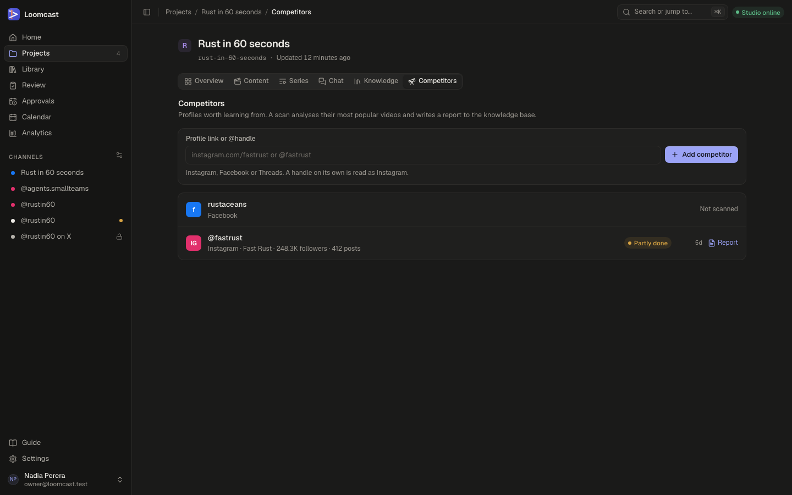
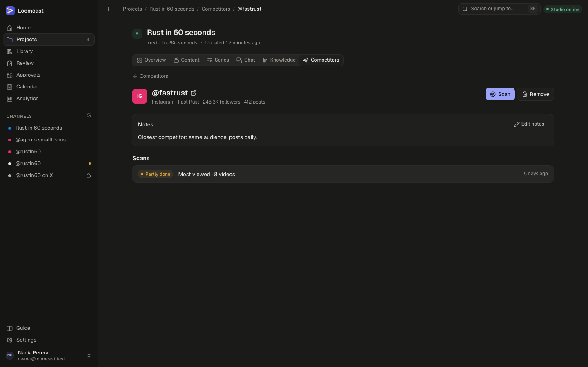
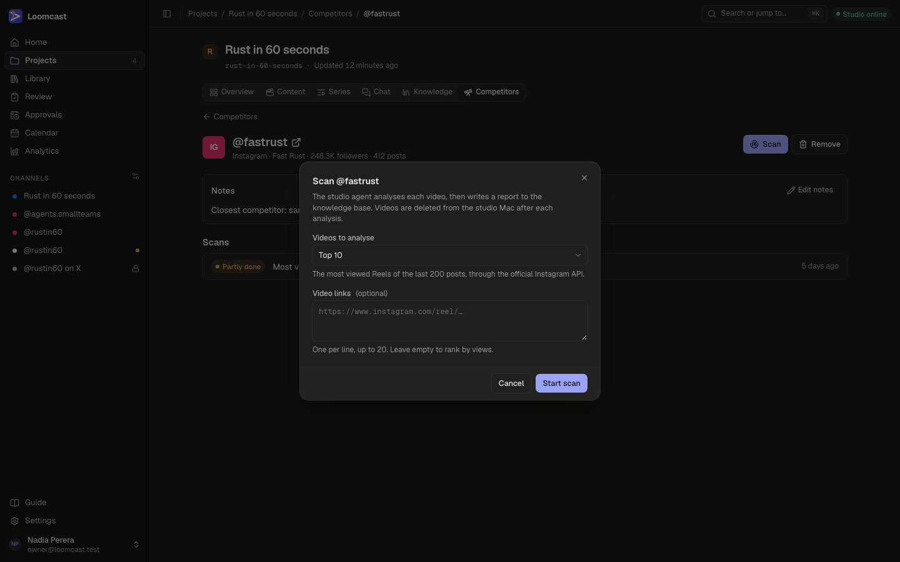
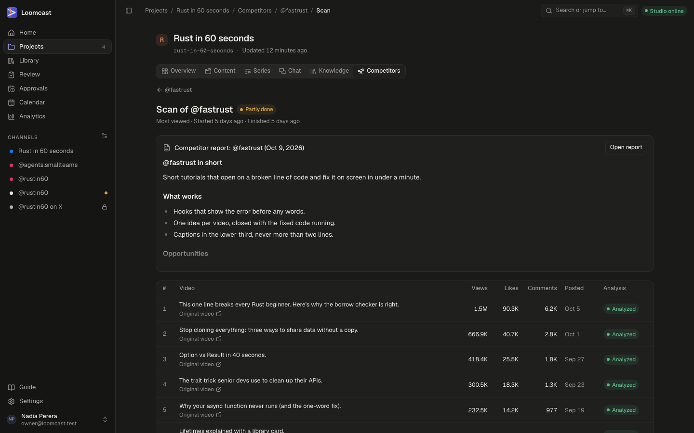

# Competitor research

Competitor research shows you which videos work best for profiles in your niche, and why. A scan picks a competitor's most popular videos, the studio agent analyses each one, and Loomcast writes a report into the project's knowledge base. The engineering details are in the [competitor research spec](../competitor-research.md).

## What it is for

Use it to learn from other creators before you plan a series or brief the producer: their hooks, pacing, length, captions and what their audience responds to.

Keep these limits in mind:

- It is internal research. Nothing from a competitor is ever published or shown outside your workspace.
- The studio agent downloads each public video to your Mac only for the length of one analysis. The video and its frames are deleted from the Mac straight afterwards, whether the analysis worked or not.
- Loomcast keeps only the transcript, the measured numbers (views, likes, comments, length, cuts per minute) and the written analysis. It never keeps the video.
- Only public videos are fetched, and never with your own accounts' logins.
- A scan analyses at most 20 videos, a competitor has one scan running at a time, and a project follows at most 50 competitors.

## Add a competitor

Competitors belong to a project. Open the project and select the **Competitors** tab.



1. In **Profile link or @handle**, paste one of:
   - an Instagram profile link, such as `instagram.com/yourbrand`;
   - a Facebook Page link, such as `facebook.com/yourbrand`;
   - a Threads profile link, such as `threads.net/@yourbrand`;
   - a handle on its own, such as `@yourbrand`. A handle on its own is read as Instagram.
2. Check the line under the field. It shows the platform and the handle Loomcast read from what you pasted.
3. Select **Add competitor**.

Nothing is fetched when you add a competitor; Loomcast only reads the platform and the handle from the link. For Instagram, the account's name, followers and post count appear after the first scan that ranks by views.

Each row in the list shows the competitor's platform, its latest scan status and how long ago it ran, and a **Report** link once a report exists. A competitor that has never been scanned shows **Not scanned**.

On an archived project the add form and the **Scan** button are hidden.

## The competitor page

Select a competitor's name to open its page.



- **The header** shows the handle (select it to open the profile in a new tab), the platform and, for Instagram, the account's name, followers and posts.
- **Scan** starts a new scan (see below).
- **Remove** stops following the competitor. Its scan history goes, but the analysed videos and the reports stay in the knowledge base, so the producer can still use them. An active scan is cancelled first.
- **Notes** is free text for your team, such as why this profile is worth following. Select **Edit notes**, write, then **Save notes**.
- **Scans** lists every scan, newest first, with its status, its source (**Most viewed** or **Pasted links**), the number of videos and when it started. Select a scan to open it.

## Start a scan

On the competitor page, select **Scan**. The dialog depends on the platform.



### Instagram

You can let Loomcast pick the videos, or paste your own.

1. In **Videos to analyse**, choose **Top 5**, **Top 10**, **Top 15** or **Top 20**. The default is **Top 10**.
2. Leave **Video links** empty to rank by views. Loomcast reads the competitor's last 200 posts through the official Instagram API and picks the most viewed Reels.
3. Select **Start scan**.

Ranking by views needs two things:

- The workspace has an **Active** Instagram channel in **Settings → Channels**. Loomcast uses its access to look the competitor up. See [Settings](settings.md) and [Channels, calendar and publishing](publishing.md).
- The competitor is a business or creator account. Instagram does not share personal accounts.

If either is missing, paste links instead: one public Reel or video link per line, up to 20. Pasted links are analysed in the order you give them, and the **Videos to analyse** choice is ignored.

### Facebook and Threads

Facebook and Threads do not let Loomcast list a profile's videos, so you always paste the links.

1. In **Video links**, paste one link to a single public video per line, up to 20. Each must be a video of this competitor's platform, not a profile or search page.
2. Select **Start scan**.

If a line is not a valid link, the dialog says which line, for example "Line 3 isn't a link to a single public Facebook video." Fix or remove it and try again.

### After you start

Loomcast shows **Scan started** and opens the scan page. A video that an earlier scan already analysed is not analysed again; its analysis is reused.

## Follow a scan

The scan page shows the scan's status, its source, when it started and finished, the report once it is written, and a table of the picked videos.



While the scan is active, the page shows a progress line such as "3 of 10 analysed" and refreshes on its own every few seconds. You can leave the page; the scan carries on.

### Scan statuses

| Status | What it means |
|---|---|
| **Analyzing** | The studio agent is downloading, transcribing and analysing the picked videos, one job per video. |
| **Writing report** | Every video has been analysed or has failed, and the studio agent is writing the report. |
| **Done** | The report is written and every video was analysed. |
| **Partly done** | The report is written, but some videos could not be analysed. Those videos show **Failed** in the table, and the report covers the rest. |
| **Failed** | No report was written. The page shows "The scan failed" with the reason, for example "None of the picked videos could be analysed." |
| **Cancelled** | Someone cancelled the scan. No report was written. |

### Video statuses

The **Analysis** column of the video table shows each video's own status: **Queued**, **Analyzing**, **Analyzed**, **Failed** or **Not analyzed**. The table also shows the views, likes, comments and posting date the platform reported at scan time. Select a video's caption to open its reference entry in the knowledge base, or **Original video** to open it on the platform.

### Cancel a scan

While a scan is active, select **Cancel scan**, then **Cancel scan** again to confirm. Analyses still waiting or running stop, and no report is written. Videos already analysed keep their analyses in the knowledge base.

## Read the report

When the scan is **Done** or **Partly done**, the scan page shows the start of the report. Select **Open report** to read it in full in the knowledge base. From the competitor list, the **Report** link opens the latest report.

The report is a **Note** entry titled "Competitor report: @handle (date)". It covers the competitor's positioning, topics, hook patterns, formats, length and pacing, what works, the opportunities for you and recommendations, followed by the same insights in structured form.

Each analysed video is also kept as a **Reference** entry with its transcript, numbers and analysis.

### Tags

Loomcast tags the entries so you can find them in the [knowledge base](knowledge-base.md) with the tag filter or search:

| Tag | On |
|---|---|
| `competitor` | Every competitor video and report |
| `competitor-ig-<handle>` | Everything about one competitor. The middle part is `ig` for Instagram, `fb` for Facebook and `th` for Threads, for example `competitor-ig-fastrust` |
| `competitor-report` | Reports only |

## Use reports when briefing the producer

The producer session searches the project's knowledge base like any other entry, so reports and video analyses are available to it without extra steps. To make sure it uses them:

1. Open the project's **Chat** tab.
2. Name the competitor or the tag in your brief, for example: "Read the latest competitor report for @fastrust and suggest three hooks for our next video that borrow what works there."
3. Ask it to say which entries it used, so you can check.

Reports are also useful when you plan a new series or format: read the "What works" section and write your own decisions into the knowledge base. See [Projects and the producer chat](projects.md) and [Series and formats](series-and-formats.md).

## Requirements

Scans run on the studio agent. Before you start one, check that:

- **The studio agent is online.** The top bar shows **Studio online**. While it is offline, the analyses wait as **Queued** and the scan stays **Analyzing**.
- **yt-dlp is installed** on the Mac (for example `brew install yt-dlp`). Without it every video fails, and the rest of Loomcast keeps working.
- **ffmpeg and ffprobe are installed** on the Mac. They check the download, count the cuts and take the frames.
- **The voice provider (ElevenLabs) key is set** on the studio agent. It is used to transcribe the videos' audio; without it every video fails. A video without speech is still analysed, from its frames alone.

See [Setting up the studio agent](studio-agent.md) for installing these and checking the agent.

To check the tools and set the key, run these on the Mac (the last two from the Loomcast repository):

```bash
yt-dlp --version
ffmpeg -version
ffprobe -version
pnpm agent secrets set voice-provider-key   # asks for the key at a hidden prompt
pnpm agent status
```

Downloads are limited to 300 MB and 10 minutes of video each, and a download that takes more than 5 minutes is stopped.

## Troubleshooting

### Starting a scan or adding a competitor

When the server refuses, the dialog shows a message in red. Find it below.

| Code | What you see | What to do |
|---|---|---|
| `not_professional_account` | "@handle isn't a business or creator account, so Instagram won't rank its Reels. Paste links to the videos you want analysed instead." | Paste links to the Reels in **Video links** and start the scan again. This also appears when the handle does not exist; check the spelling. |
| `no_instagram_channel` | "Ranking Reels by views needs a connected Instagram channel. Connect one in channel settings, or paste links to the videos instead." | Connect an Instagram account in **Settings → Channels**, or reconnect it if its status is **Needs reconnect**. Or paste links. |
| `links_required` | "Facebook doesn't let Loomcast list a profile's videos. Paste links to the videos you want analysed." (or Threads) | Paste at least one video link. |
| `invalid_link` | "Some links are not public video links of the competitor's platform." | Each line must link to one public video on the competitor's platform. Remove profile links, search pages and links from other platforms. |
| `no_videos` | "The account has no recent videos to analyse. Paste links to the videos instead." | The last 200 posts hold no video. Paste links to older videos, or pick another competitor. |
| `platform_error` | "Loomcast had a problem on its side. Try again in a moment." | Instagram refused the lookup. Try again later. If it keeps happening, reconnect the Instagram channel in **Settings → Channels**, or paste links. |
| `not_configured` | "Loomcast had a problem on its side. Try again in a moment." | The server has no Meta app set up, so ranking by views is not available. Paste links, and ask the person who runs the server to configure it (see [Deploying and running the server](operations.md)). |
| `scan_in_progress` | "A scan of this competitor is already running. Wait for it to finish, or cancel it first." | Open the active scan from the competitor page and wait, or select **Cancel scan**. |
| `limit` | "This project already follows @handle on Instagram." | The project follows 50 competitors, the most it can. Remove one you no longer need, then add the new one. |

When adding a competitor, the same "already follows" message also means what it says: the project already follows that profile on that platform. Open it from the list instead.

### A scan that fails or stalls

| Symptom | What to do |
|---|---|
| The scan stays **Analyzing** and every video shows **Queued** | The studio agent is offline. Start it on the Mac; see [Setting up the studio agent](studio-agent.md). |
| Every video shows **Failed** and the scan is **Failed** with "None of the picked videos could be analysed." | Something on the Mac is missing. The usual causes are yt-dlp not installed, or no voice provider key on the studio agent. Fix it (see [Requirements](#requirements)), then start a new scan. The agent's log names the cause; see [Troubleshooting](troubleshooting.md). |
| Some videos show **Failed** and the scan is **Partly done** | The report covers the videos that worked. A video can fail when it was deleted, is private, is longer than 10 minutes or larger than 300 MB, or the download timed out. Start a new scan to try again; analysed videos are reused. |
| The scan is **Failed** with "The report could not be queued from the analyses." or another report error | The analyses are kept. Start a new scan; the analysed videos are reused and only the report is written again. |
| A video's transcript is empty | The video has no speech or music only. Its analysis then works from the frames and the measured numbers. |
