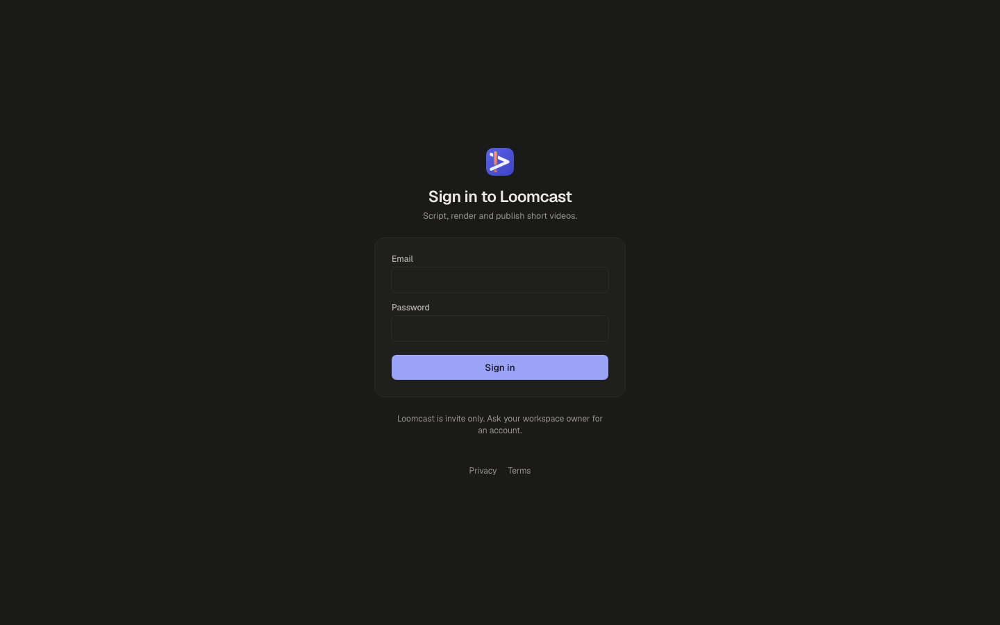
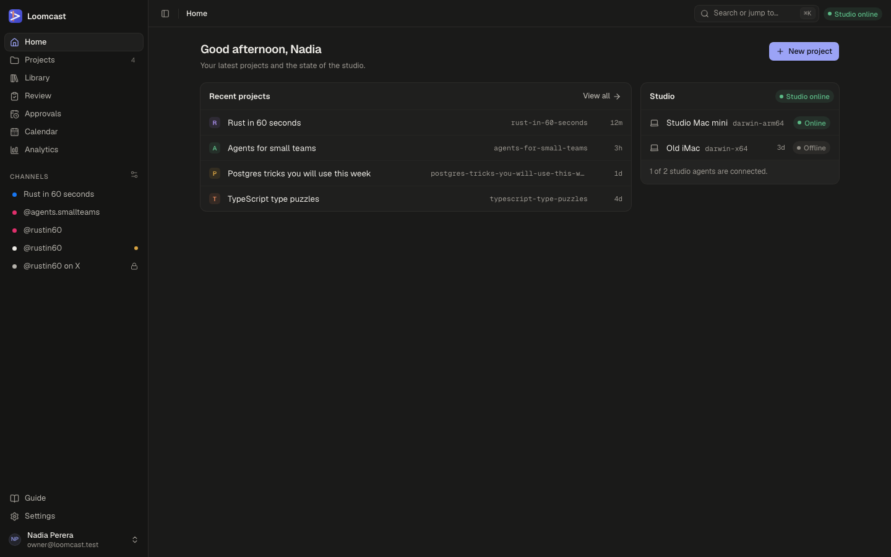

# Getting started

Loomcast helps you plan, produce, review and publish short vertical videos for Instagram, Facebook and Threads. This page explains how the pieces fit together, takes you round the screen, and lists what to set up on your first day.

## What Loomcast is

Loomcast is a control plane. It has two halves:

- **The web app** is where you plan, review, schedule and publish. Projects, series, ideas, the review queue, the calendar, analytics and the connected channels all live here.
- **The studio agent** is a small program that runs on a paired Mac. It does the producing: it researches and chats with you through the producer session, writes scripts, cuts storyboards, records the voice with the voice provider (ElevenLabs) and renders the final MP4.

Nothing heavy runs on the server. The server keeps the records, hands work to the studio agent as jobs, stores the finished media and sends posts to the platforms at their slots. When the studio agent is offline, work waits in a queue and starts as soon as it reconnects.

| Who does it | What |
|---|---|
| You, in the web app | Create projects and series, set format rules, add ideas and knowledge, review and approve videos, connect channels, move posts on the calendar |
| The studio agent on the Mac | Chat replies, scripts, storyboards, revisions, voice takes, renders, competitor analyses |
| The server | Plans the cadence, queues jobs, approves automatically where the rules allow, publishes at the slot |

## Signing in

Loomcast is invite only. There is no sign-up page: the workspace owner creates your account and sends you a link.

1. Open your Loomcast address, for example `https://loomcast.example.com`.
2. Enter your **Email** and **Password**.
3. Press **Sign in**.

If you see "That email and password don't match", check both and try again. If you have forgotten your password, ask the workspace owner for a new password link.

### Setting your password from a link

Invitations and password resets both arrive as a link that opens a **Set your password** page (titled **Join Loomcast** for a new invitation).

1. Open the link exactly as you received it.
2. Type a **New password** of at least 12 characters, and type it again in **Confirm password**.
3. Press **Set password**, then sign in with the new password.

Each link works once. Invitation links last 7 days and reset links 24 hours; the page shows when yours expires. If the page says "This link has expired or was already used", ask the owner for a new one. Setting a new password from a reset link ends your other sessions.

## A tour of the screen

After you sign in you land on **Home**. It shows your most recent projects and the state of the studio: which paired studio agents are connected right now.

### The sidebar

The main section of the sidebar takes you to the places you use every day:

| Item | What it is for |
|---|---|
| **Home** | Recent projects, the studio status and a **New project** button |
| **Projects** | Every project, with the number of active ones next to it |
| **Library** | Every video across all projects, with search and filters by state, series and target date |
| **Review** | Videos waiting for a decision, nearest target date first |
| **Approvals** | Videos that must be approved before their slot, and missed posts |
| **Calendar** | Planned and queued posts and the open slots, by week or month |
| **Analytics** | How published posts perform |

Below it, **Channels** lists the social accounts your series publish to. Pressing a channel opens the calendar filtered to that channel. A lock icon means the platform can only dry-run on this server; an amber dot means the channel needs reconnecting. The settings icon next to the heading opens **Settings → Channels**.

At the bottom of the sidebar:

- **Guide** opens these pages. Each page lists its sections under **On this page**, and the command palette finds guide pages too: type a word such as "pair" or "offline".
- **Settings** holds devices, access tokens, members (owner only), channels and the scheduler. See [Settings](settings.md).
- **The user menu** (your name and email) has the **Theme** choice (**Light**, **Dark** or **System**) and **Log out**.

The button at the top left of the page hides or shows the sidebar (⌘B, or Ctrl+B).

### The top bar

- **Breadcrumbs** show where you are, for example Projects / Rust in 60 seconds / Chat. Each part is a link.
- **Search or jump to…** opens the command palette. Press ⌘K (Ctrl+K on Windows and Linux) from anywhere. Type to find pages, projects, videos, knowledge base entries and guide pages, or to run actions such as **New project** and switching the theme.
- **The studio status pill** shows **Studio online** when at least one paired studio agent is connected, **Studio offline** when none is, and **No studio** when none has been paired yet. Hover over it for details; press it to open **Settings → Devices**.

## The life of a video

Every video in Loomcast follows the same path. In short:

1. **Plan.** A project holds a series, and the series has a format: its tone, length, voice, look and cadence. See [Projects and the producer chat](projects.md) and [Series and formats](series-and-formats.md).
2. **Idea.** A video starts as an idea: a title and an optional pitch. You add ideas yourself, or the server plans one for each upcoming slot of the series' cadence.
3. **Produce.** The studio agent writes the script, cuts the storyboard, records the voice and renders the video. Each step runs as a job on the Mac. The states are **Idea**, **Script**, **Storyboard**, **Voice** and **Render**.
4. **Review.** The finished video is **In review** and waits in **Review**. You approve it, ask for changes (the producer revises it and brings it back) or reject it. See [Videos and review](videos-and-review.md).
5. **Schedule.** An approved video is queued on each channel of its series for its slot, and becomes **Scheduled**. See [Publishing](publishing.md).
6. **Publish.** At the slot the server sends the post, or, while a channel is in dry run, records exactly what it would have sent. The video becomes **Published**.

Research feeds every step: the [knowledge base](knowledge-base.md) and [competitor research](competitor-research.md) are what the studio agent reads before it writes.

## Roles

A workspace has two roles.

| Role | Who | What they can do |
|---|---|---|
| **Owner** | One person, the account created when Loomcast was installed | Everything, including **Settings → Members** (invite people, send new password links, disable access), access tokens with the `mcp:admin` scope and the operations status |
| **Admin** | Everyone the owner invites | Everything else: projects, series, formats, reviews, the calendar, channels, devices, their own access tokens and **Settings → Scheduler** |

There is exactly one owner, and the owner's account cannot be disabled. When the owner disables someone's access, that person is signed out everywhere, their access tokens stop working and the studio agents they paired are disconnected. Their work stays in the workspace.

## First-time setup checklist

Do these once, in this order. Each step links to the page with the details.

1. **Pair the studio agent.** Install the studio agent on the Mac that will do the producing and pair it from **Settings → Devices**. Until it is paired, the status pill reads **No studio** and nothing gets produced. See [The studio agent](studio-agent.md).
2. **Connect your channels.** Add the accounts you publish to in **Settings → Channels**. Every new channel starts in dry run, so nothing goes out until you decide. See [Publishing](publishing.md).
3. **Create a project.** Press **New project** on Home or on the Projects page, then add a series and set its format. See [Projects and the producer chat](projects.md) and [Series and formats](series-and-formats.md).
4. **Add knowledge.** Save reference videos, decisions and brainstorms in the project's **Knowledge** tab, so the studio agent writes in your voice from the first script. See [The knowledge base](knowledge-base.md).

When the pill shows **Studio online**, send a first message in the project's **Chat** tab to check that the studio agent answers. If something does not work, see [Troubleshooting](troubleshooting.md).
