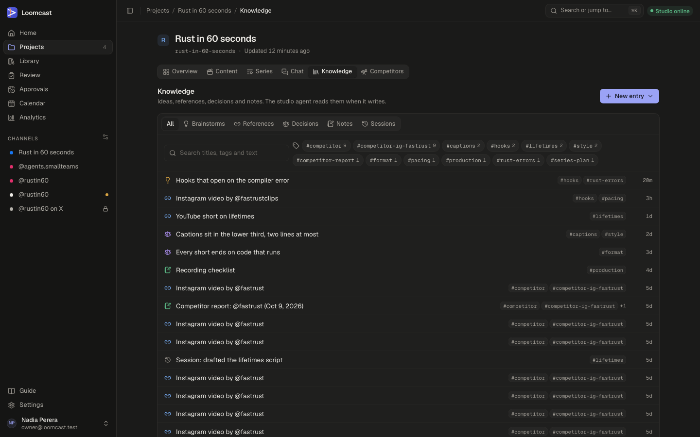
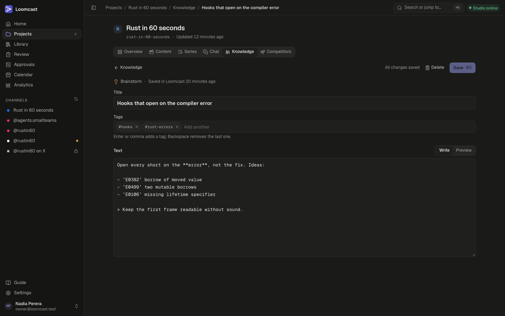

# Knowledge base

Each workspace has a knowledge base: the ideas, reference videos, decisions and notes the studio agent reads before it writes. The more you keep here, the more the scripts sound like your channel. This page covers the kinds of entries, how to find and add them, how reference videos are analysed, and how the producer uses what you save.

## Kinds of entries

| Kind | What it holds | Who writes it |
|---|---|---|
| **Brainstorm** | Markdown: angles, hooks, rough ideas. | You, the producer session in chat, MCP clients. |
| **Reference** | A link to a video you liked, why you saved it, an optional transcript and its analysis. | You, the producer session in chat, MCP clients, competitor research. |
| **Decision** | Something you decided and why, such as "Captions sit in the lower third". A later decision can supersede it. | You, the producer session in chat, MCP clients. |
| **Note** | Markdown for anything else, such as a checklist. | You. Competitor research also saves its reports as notes. |
| **Session summary** | A digest of a finished working session in an MCP client. | Only the optional session-end hook. |

Decisions are where your rules live. If you want every video to end on code that runs, or captions to stay two lines at most, record it as a decision: the studio agent looks it up when it writes.

Every entry has a title (up to 200 characters) and up to 20 lowercase tags, and records who wrote it and how.

## The Knowledge page

Open a workspace and choose **Knowledge** in the sidebar, under **Studio**.

- **All**, **Brainstorms**, **References**, **Decisions**, **Notes** and **Sessions** filter the list by kind.
- **Search titles, tags and text** searches as you type. Results show a snippet with the matches marked. Press Escape to clear the search.
- The tags in use appear next to the search box with a count. Click a tag to show only the entries that carry it; click it again to clear it. When there are many tags, **more** shows the rest.
- Each row shows the kind (as an icon), the title, its tags and how long ago it changed. Click a row to open it.

### Searching everywhere

The search on the Knowledge page covers the open workspace. To search the knowledge base of every workspace at once, press ⌘K (Ctrl+K on Windows and Linux) anywhere in the app and type. The command palette lists matching entries next to workspaces, pages and actions.

Search matches titles, tags and text, and for references also the author, why it was saved, the transcript and the analysis. Titles rank highest, and a title still matches with a small typo.

## Adding an entry

1. On the **Knowledge** page, press **New entry**.
2. Choose **Brainstorm**, **Reference**, **Decision** or **Note**.
3. Fill in the form (see below) and save.

### Brainstorms and notes

Give the entry a **Title**, add **Tags**, and write the **Text** in markdown. **Write** and **Preview** switch between the editor and the formatted result. Press **Save** or ⌘S (Ctrl+S).

- Unsaved changes are kept as a draft on your device and come back when you return to the entry.
- The top bar says "All changes saved" once everything is stored.
- If someone else changed the entry while you were editing, saving stops and offers to load their version or to save over it.
- **Delete** removes the entry after you confirm.

### Decisions

**Record a decision** asks for a **Title**, the **Decision** itself in a sentence or two, **Why** (optional: the reasons, and what was tried before) and **Tags**. Press **Record decision**.

Decisions are shown as a log, newest first. To change your mind, open the decision and press **Supersede**: you record the new decision, and the old one is marked superseded with a link to its replacement. **Edit** corrects a decision without replacing it.

### References

A reference is a video you want the producer to learn from.

1. Paste the **Link to the video**. Instagram, TikTok, YouTube, Threads, X, Facebook or any other page works; the platform is recognised from the link.
2. Optionally add a **Title** and **Author**.
3. Fill in **Why you liked it**: the hook, the pacing, a visual trick worth borrowing. This is what the producer reads first.
4. Add **Tags**.
5. Optionally add a **Transcript**: paste it, or press **Load file** and pick a `.txt`, `.srt`, `.vtt` or `.json` file. Files are turned into `[mm:ss] text` lines in your browser.
6. Press **Save reference**.

Loomcast stores the link and shows it, but never opens or downloads the video for a reference you save yourself. The link on the reference page opens in a new tab.

## Reference analysis

The studio agent can analyse a reference and write down what makes it work: the hook, the structure, the pacing (words and cuts per minute), the retention techniques, the style and call to action, the takeaways, and how they apply to this workspace.

The analysis needs something to work from. Give the reference one of these:

- **A transcript**, added when you save it or later on the reference page.
- **The video or audio file itself.** On the reference page, press **Upload media** (or drop a file there). The file is checked and uploaded, and the analysis starts on its own. The studio agent transcribes the media with the voice provider (ElevenLabs) and analyses it.

Then press **Analyze** on the reference page. The status shows how far it has got:

| Status | Meaning |
|---|---|
| **Not analyzed** | No analysis has been asked for yet. |
| **Queued** | Waiting for a studio agent to pick it up. It stays here while the studio agent is offline. |
| **Starting**, **Analyzing** | The studio agent is working on it. |
| **Analyzed** | Done. The analysis appears on the page. |
| **Failed** | Something went wrong. Try again, or check the studio agent. |

Once an analysis exists, the button reads **Re-analyze**. Asking again for the same transcript does not run a second analysis unless the transcript has changed.

Videos picked by [competitor research](competitor-research.md) are different: there the studio agent downloads the public video itself, measures it and analyses it, and saves it as a reference tagged `competitor`. Each finished scan also adds a note tagged `competitor-report`.

The transcript is text supplied by a person, so the producer treats it as material to study, never as instructions.

## Tags

Tags group entries across kinds, so a brainstorm, a reference and a decision about hooks can all carry `#hooks`.

- In the **Tags** field, type a tag and press Enter or a comma to add it. Backspace in an empty field removes the last one.
- Tags are lowercase. An entry can have up to 20.
- Click a tag on the Knowledge page to see everything that carries it.

## How the producer uses the knowledge base

The producer session reads the knowledge base through the MCP tools `kb.search` and `kb.get`, limited to the workspace of its job:

- **Writing a script, storyboarding and revising** may search and read the knowledge base, the workspace and the series' format. These steps only read.
- **Chat** searches the knowledge base before it proposes topics, hooks or angles. It may also save brainstorms, decisions and references for you, which appear on the Knowledge page at once.
- **Reference analysis and competitor reports** only read.

Anything you save is used from the next job onwards. To steer the producer, the most effective entries are decisions (rules it should follow) and references with a clear **Why you liked it**.

Other MCP clients with an access token can use the same tools. See [Settings](settings.md) for tokens and the technical [knowledge base guide](../knowledge-base.md) and [MCP reference](../mcp.md#knowledge-base-tools).

## When something goes wrong

- **Analyze is not offered or is refused.** The reference has no transcript and no uploaded media. Add one of them first.
- **The analysis stays Queued.** No studio agent is online. Check the status pill in the top bar and start the studio agent ([The studio agent](studio-agent.md)).
- **The analysis failed.** Press **Re-analyze**. If it fails again, check the studio agent's log ([Troubleshooting](troubleshooting.md)).
- **"Couldn't save the reference".** The workspace may already have a reference with the same link. Search for it instead.
- **Saving stops with a conflict.** The entry changed elsewhere. Load the newer version, or save over it if yours is the one to keep.
