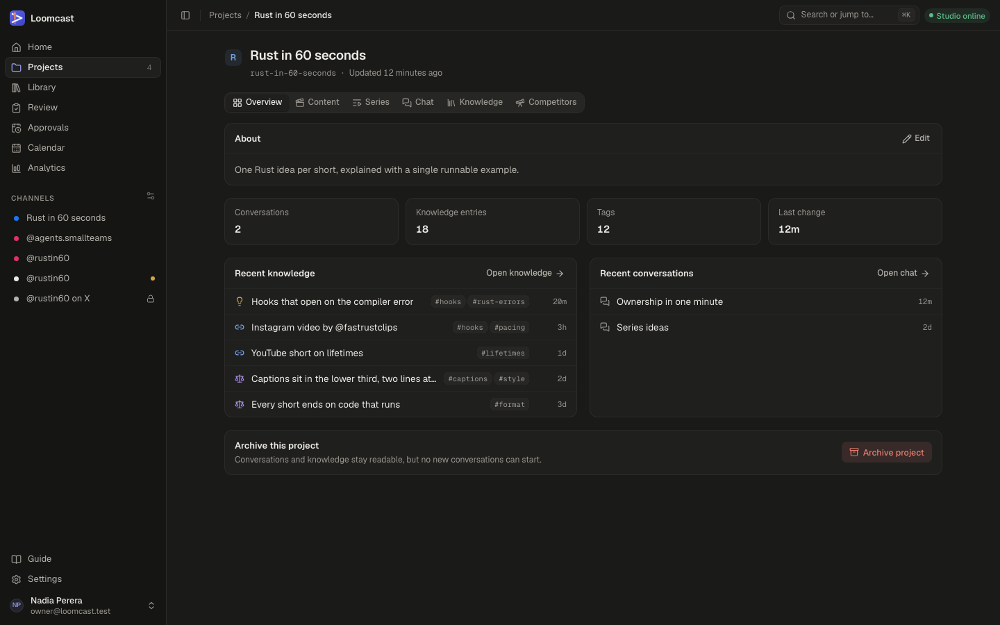

# Projects and the producer chat

A project collects everything for one series or topic: its conversations with the studio agent, its knowledge base, its competitor research, its series and its videos. This page covers the projects list, creating and archiving a project, the overview, and the **Chat** tab where you talk to the producer session on the studio agent.

## The projects list

Open **Projects** in the sidebar. The number next to it is the count of active projects.

Each row shows the project's name, its slug and how long ago it last changed. Press a row to open the project. The tabs at the top of the card filter the list:

- **Active**: projects you are working on.
- **Archived**: projects you have put away. They stay readable.
- **All**: both.

You can also jump to a project from anywhere with the command palette (⌘K): type part of its name or slug.

## Creating a project

1. Press **New project** on the Projects page or on Home. You can also run **New project** from the command palette.
2. Type a **Name**, for example "Rust in 60 seconds". Below the field, **Slug** shows the short address name Loomcast will use.
3. Optionally add a **Description**: what the videos are about and who they are for. The studio agent reads it, so a clear sentence helps.
4. Press **Create project**.

A "Project created" message appears with an **Open** button. Slugs never change, so pick a name you are happy with.

## Inside a project

Every project has the same tabs:

| Tab | What it is for |
|---|---|
| **Overview** | The description, a few counts, recent knowledge and recent conversations |
| **Content** | The project's videos and where each one is in production. See [Videos and review](videos-and-review.md) |
| **Series** | The series and their formats, cadence and channels. See [Series and formats](series-and-formats.md) |
| **Chat** | Conversations with the studio agent, below |
| **Knowledge** | Brainstorms, references, decisions and notes. See [The knowledge base](knowledge-base.md) |
| **Competitors** | Accounts you follow and what their videos do. See [Competitor research](competitor-research.md) |

### The overview

- **About** holds the description. Press **Edit** to change it, then **Save** (or ⌘Enter). Escape cancels.
- The counts show **Conversations**, **Knowledge entries**, **Tags** and **Last change**.
- **Recent knowledge** lists the latest knowledge base entries; **Open knowledge** opens the Knowledge tab.
- **Recent conversations** lists the latest chats; **Open chat** opens the Chat tab.

## Archiving a project

Archive a project when you stop working on it. Its conversations and knowledge stay readable, but no new conversations or messages can be added, and its series and formats can no longer be changed.

1. Open the project's **Overview** tab.
2. In **Archive this project**, press **Archive project**.
3. Confirm with **Archive project** in the dialog.

The project moves to the **Archived** filter of the projects list, and its header shows an **Archived** badge. The web app has no button to restore an archived project.

## The producer chat

The **Chat** tab is where you work with the studio agent in plain language. Each message you send becomes a job. The studio agent on your Mac picks it up and runs one turn of a producer session inside the project's own folder on the Mac, and the reply streams back into the conversation as it is written.

### Starting and continuing a conversation

- The left column lists the project's conversations, most recent first. Press one to open it. On a phone, the list becomes a picker above the thread.
- Press **+** at the top of the list to start a **New conversation**. If the project has no conversations yet, your first message starts one.
- A conversation without a title is named after when it started, for example "Conversation, Oct 14, 9:30 AM".
- Type in the box at the bottom and press **Send**, or ⌘Enter (Ctrl+Enter). Enter on its own adds a new line.

Each conversation keeps its producer session, so the studio agent remembers what was said earlier in the same conversation. Start a new conversation for a new subject; it starts with a clean slate.

Replies are formatted: headings, lists, tables and code blocks. Code blocks have a **Copy** button.

### What the studio agent can do in a chat

In a chat turn the producer session can:

- search and read the project's knowledge base;
- save to the knowledge base: brainstorms, decisions (with their rationale) and references to videos;
- read the project's details, such as its description;
- search the web and read web pages;
- read and write files in the project's folder on the Mac.

Use the chat to research a topic, brainstorm angles and hooks, draft or rework a script, plan a run of videos, or record a decision so that later scripts follow it. Ask it to save what you agreed ("save these five hooks as a brainstorm") and it appears in the **Knowledge** tab.

The chat does not produce videos by itself. To turn an idea into a video, add it with **New idea** in the **Content** tab, the **Library** or on a series, then produce it. See [Videos and review](videos-and-review.md).

### The status line

While a reply is on its way, a status line sits above the message box:

| Status | Meaning |
|---|---|
| **Queued** | The message is saved and the job waits for the studio agent |
| **Waiting for studio agent (offline)** | The studio agent that holds this conversation, or every paired one, is offline |
| **Waiting for studio agent (none paired)** | No studio agent has been paired yet |
| **Starting** | The job was sent to the studio agent |
| **Running** | The studio agent is working. The detail says what it is doing, for example "Thinking", "Writing the reply" or the tool it is using |
| **Cancelling** | You pressed **Cancel** and the studio agent is stopping |
| **Failed** | The reply did not finish. The detail says why |
| **Cancelled** | You stopped the reply |

While a reply is queued or running you can press **Cancel**. After **Failed** or **Cancelled**, press **Retry** to send the same words again as a new message. A reply you stopped is marked **Studio agent (stopped)**.

### When the studio is offline

You can send messages while the studio agent is offline. Each message is saved straight away and its job waits in the queue, showing **Waiting for studio agent (offline)**. When the studio agent reconnects it picks the job up and the reply streams in. You do not need to keep the page open.

A conversation that already has a producer session stays with the studio agent that holds it. If you have paired more than one Mac, its messages wait for that Mac, even when another one is online. Start a new conversation to use the Mac that is online.

Common failures and what to do:

| Detail on a failed reply | What to do |
|---|---|
| "The studio agent lost its connection while working on this." | The Mac went to sleep, lost its network or the agent restarted. Check the studio status pill, then press **Retry** |
| "The reply took too long and was stopped." | Ask for less in one message, or split the task, then retry |
| "The producer session on the studio agent is signed out." | Sign the producer runtime in again on the Mac. See [The studio agent](studio-agent.md) |
| "This studio agent can't answer messages yet. Update it and try again." | Update the studio agent on the Mac |

More causes are in [Troubleshooting](troubleshooting.md).

## Tips for good briefs

- **Say what you want back.** "Draft a 45-second script with a hook, three beats and a payoff" works better than "write something about lifetimes".
- **Give the constraints.** Length, audience, reading level, what to avoid, and the one example the video is built around.
- **Point to what you already know.** "Use the decisions in the knowledge base about captions" or "follow the reference video I saved yesterday". The studio agent searches the knowledge base, but naming the entry helps.
- **Keep one subject per conversation.** A long conversation about many things is slower and drifts.
- **Save the outcome.** When you agree on hooks, angles or rules, ask the studio agent to save them as a brainstorm or a decision. Script jobs read the knowledge base too, so saved decisions shape later videos.
- **Put lasting rules in the format.** Tone, length, hook style and the topic pool belong in the series format, not in a chat message. See [Series and formats](series-and-formats.md).
