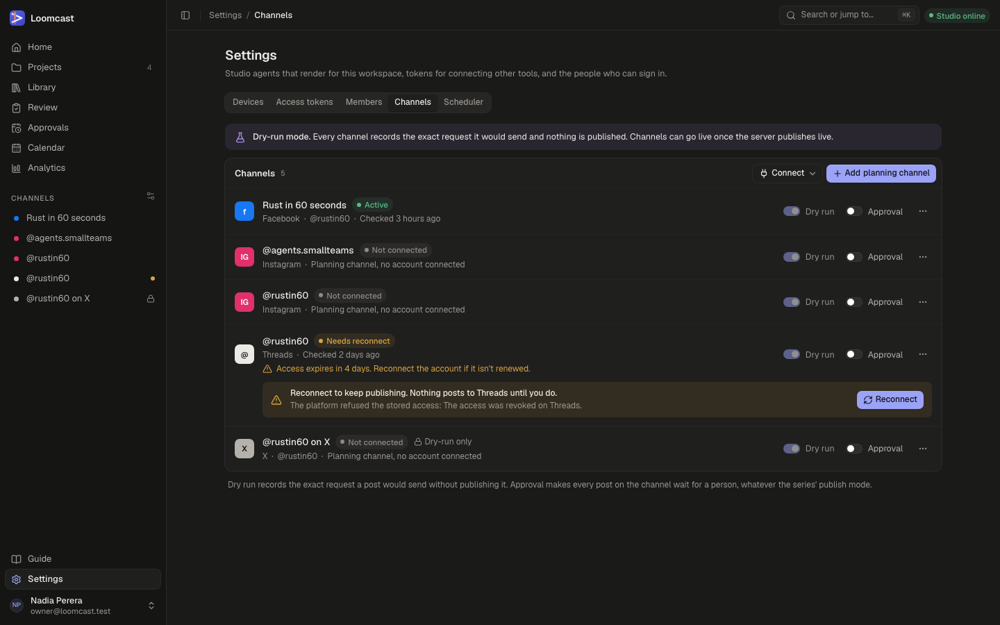
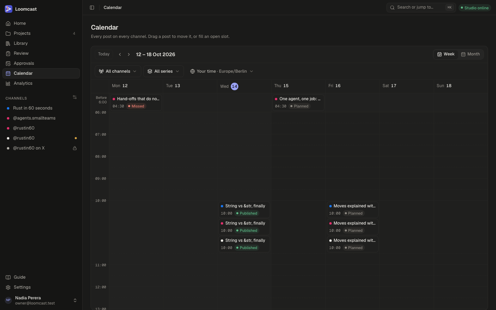
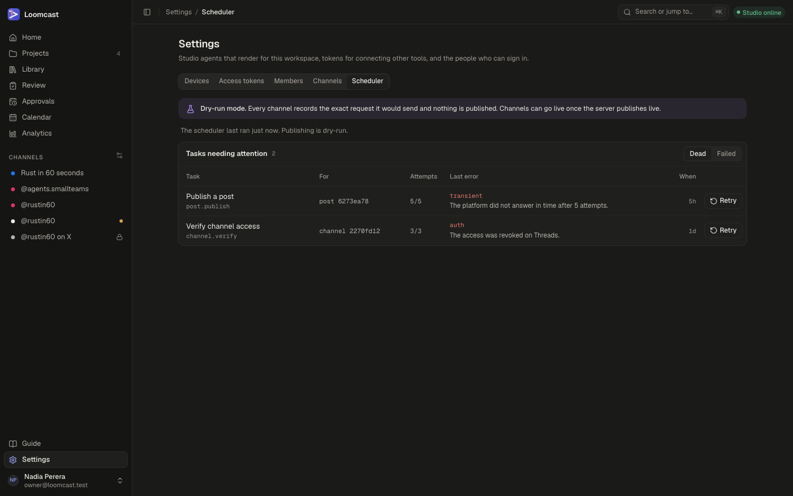
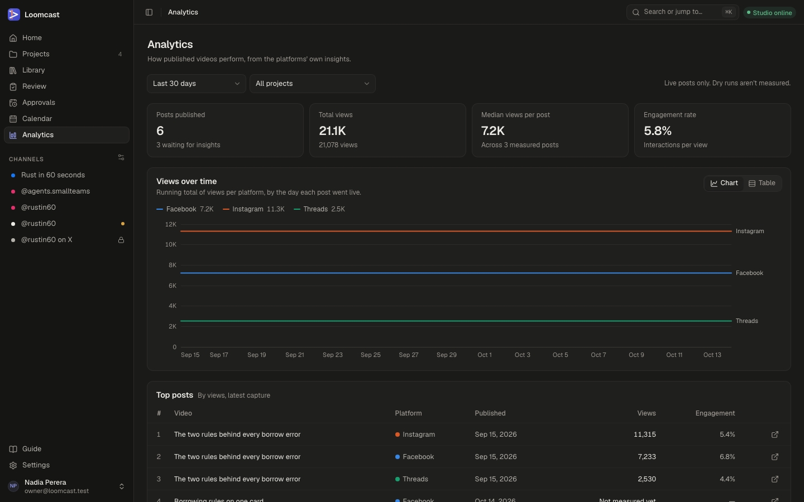

# Channels, calendar and publishing

A channel is an account a series publishes to: a Facebook Page, an Instagram professional account or a Threads profile. This page explains how to connect channels, how dry run keeps posts from going out until you are ready, how the calendar and scheduling work, what "published" means, and where to see how your videos perform.

## Channels

Channels are managed in **Settings → Channels**. The sidebar also lists them under **Channels**: click one to open the calendar filtered to it. A dot next to a channel means it needs reconnecting, and a lock means it can only dry-run on this server.

Each row shows the channel's name, its platform and handle, its status and when its access was last checked:

| Status | Meaning |
|---|---|
| **Active** | Connected and working. |
| **Not connected** | A planning channel: you can plan posts on it, but no account is connected yet. |
| **Needs reconnect** | The platform refused the stored access. Nothing posts to it until you reconnect. |
| **Disabled** | Switched off. |

The **⋯** menu on a row offers **Rename…**, **Reconnect** and **Disconnect**.

### Connecting an account

Facebook Pages and Instagram accounts connect through one Meta sign-in. Threads has its own.

1. Go to **Settings → Channels** and press **Connect**.
2. Choose **Facebook Page and Instagram** (Pages and their linked Instagram accounts) or **Threads**.
3. Sign in with the platform and allow every permission it asks for. For Facebook, choose the Page (and its business) in the dialog.
4. Back in Loomcast, **Choose accounts** lists what the sign-in can publish as. Tick the accounts you want and press **Connect account** (or **Connect 2 accounts**).

An Instagram account is always connected together with its Facebook Page, because the Page holds the access. New channels start in dry run.

If the connect page says the platform "isn't set up on this server", the server has no app settings for it yet. The workspace owner adds them by following the [Meta app runbook](../runbooks/meta-app-setup.md).

### Planning channels

You can plan before you connect anything. **Add planning channel** creates a channel with a **Platform**, a **Name** (such as the account's handle) and an optional **Requires approval** switch. Series can publish to it and the calendar fills up, but its posts only dry-run. Connect the real account later and the channel keeps its name, switches and posts.

### Linking a series to channels

A series publishes to the channels switched **On** in the **Channels** card on its series page. Switching a channel on plans posts for the series' upcoming slots on it; switching it off removes the planned posts that have not been attempted. See [Series and formats](series-and-formats.md) for the publishing cadence.

### Reconnecting

When a channel shows **Needs reconnect** (or a warning such as "Access expires in 4 days"), press **Reconnect** on its banner or in its **⋯** menu and sign in again. Reconnecting keeps the channel's name, switches and posts. **Disconnect** removes the stored access and switches the channel back to dry run; its series links and posts stay.

## Dry run and live publishing

Nothing reaches a platform unless every switch allows it.

- **The server's publishing mode.** The server either only dry-runs or publishes live. While it dry-runs, **Settings → Channels** and **Settings → Scheduler** show a "Dry-run mode" banner, and no channel can go live. This is set by whoever runs the server ([Operations](operations.md)).
- **The channel's Dry run switch.** On for every new channel. A channel in dry run only simulates posting.
- **The post itself.** A post planned while its channel (or the server) was in dry run stays a dry run, even after the channel goes live.

### What a dry run does

A dry-run post goes through the same checks as a real one (video length, size and aspect, caption limits) and records the exact request it would have sent. It never contacts the platform. The post then shows **Published**, and the video moves to **Published** too, but nothing appeared on the platform. Dry runs are left out of analytics.

Use dry run to check that a series, its cadence and its channels behave before anything goes out.

### Going live on a channel

1. Make sure the server publishes live and the channel is **Active**.
2. Turn the channel's **Dry run** switch off.
3. The dialog lists what the server checks. Type `publish live` and press **Publish live**, or **Keep dry-run** to back out.

Turning **Dry run** back on holds back posts that are already queued on the channel.

### The Approval switch

**Approval** on a channel makes every post on it wait for a person to approve the video, whatever the series' publish mode. Without it, a series whose format is set to **Publish automatically** approves its own videos when they enter review.

### Approval rules

How a post is approved depends on the series' format and the channel:

| Format **Publish mode** | Channel **Approval** | The video needs |
|---|---|---|
| **Publish automatically** | Off | Nothing: the system approves it when it enters review. |
| **Publish automatically** | On | A person's approval. |
| **Wait for approval** | Either | A person's approval. |

A video waiting for a person appears in **Review** and in **Approvals** ([Videos, review and approvals](videos-and-review.md#approvals)). Once approved, its planned posts are queued with the approved version and the video moves to **Scheduled**. If the video is edited after approval (a new script, storyboard or voice), its posts go back to planned until it is approved again, so an unapproved version is never published.

## The calendar

**Calendar** in the sidebar shows every post on every channel. Drag a post to move it, or fill an open slot.

- **Week** and **Month** switch the view. **Today**, the arrows, and the ← → and t keys move between periods.
- **All channels** and **All series** filter the posts.
- **Your time** shows times in your browser's time zone. When the shown series share one time zone, you can switch to **Series time**.
- Each post shows its video's title, its time, a dot in the channel's colour and its state.

Post states:

| State | Meaning |
|---|---|
| **Planned** | Holds a slot; its video is not approved yet. |
| **Queued** | The video is approved; the post waits for its time. |
| **Publishing** | Being sent, or the platform is still processing it. |
| **Published** | Live, or recorded as a dry run. |
| **Failed** | The publisher gave up. The reason is on the post. |
| **Cancelled** | Withdrawn by a person, or no longer needed. |
| **Missed** | Its time came while its video was still waiting for approval. |

### Moving a post

Drag a planned, queued, failed or missed post to another time. With the keyboard, focus the post, press Space to pick it up, move it with the arrow keys (by half an hour or a day in the week view, by a day or a week in the month view) and press Space again to drop it, or Escape to cancel. The new time must be at least two minutes ahead. Click a post to open its video.

### Scheduling an approved video into a slot

The series' cadence creates slots. An open slot (one no post holds) is drawn with a dashed outline.

1. Click the open slot.
2. **Fill this slot** lists the series' approved videos. Pick one.
3. Press **Schedule**.

The post is queued at once, because the video is already approved. If the dialog says "No approved videos to schedule", approve a video of that series in review first.

## What "published" means

A post is **Published** when the platform has accepted it and it is live, or, for a dry run, when the request has been recorded. The video moves to **Published** with its first published post.

To see a live post, open the video. Its page shows a **Performance** card with each live post, and **Open on Instagram** (or the post's platform) opens the post itself. Dry-run posts have no link, because nothing was posted.

If a post fails, the calendar shows it as **Failed** and the reason is kept on the post. Fix the cause (for example reconnect the channel), then drag the post to a new time to queue it again.

## The scheduler

The server runs the cadence, starts production ahead of each slot and publishes posts as scheduled tasks. **Settings → Scheduler** (owner and admins) shows when the scheduler last ran and whether publishing is live, dry-run or paused.

**Tasks needing attention** lists tasks that gave up. **Dead** tasks used up every attempt; **Failed** tasks hit an error that retrying cannot fix. Each row shows the task (for example "Publish a post" or "Verify channel access"), what it was for, the attempts, the last error and when it happened.

1. Read the last error and fix the cause. An `auth` error usually means a channel needs reconnecting.
2. Press **Retry**. The task runs again now with a fresh set of attempts.

If the banner says "Publishing is paused.", posts that come due wait until publishing is switched back on.

## Analytics

**Analytics** in the sidebar shows how published videos perform, from the platforms' own insights. Only live posts are measured; dry runs are not.

- Choose a range (**Last 7 days**, **Last 30 days**, **Last 90 days**, **Last 12 months**) and a project.
- The tiles show **Posts published** (and how many still wait for insights), **Total views**, **Median views per post** and **Engagement rate**.
- **Views over time** shows a running total per platform. **Chart** and **Table** switch the view.
- **Top posts** lists posts by views, with a link to each post on its platform.
- **Series** lists your series; open one for views and watch time per post.

Insights arrive about an hour after a post goes live, and are updated again over its first month. A video's own page shows the same figures for its posts in the **Performance** card.

## Instagram account won't connect

If the Facebook sign-in works but no Instagram account is offered, or the sign-in fails, check these in order:

1. **The account is a professional account.** In the Instagram app, open **Settings → Account type and tools** and make sure it is a **Business** or **Creator** account, not a personal one.
2. **It is linked to a Facebook Page you manage.** In the Page's settings, under **Linked accounts**, the Instagram account must be connected. Without the link, the Page sign-in offers no Instagram account.
3. **You sign in with the Facebook account that manages the Page.** Signing in with another Facebook account shows no Page, or "No accounts to connect".
4. **Allow every permission** in the Facebook dialog and select the Page. Declining a permission or skipping the Page leaves nothing to connect.
5. **If Instagram's web login is blocked in the browser**, log in once on the Instagram phone app, or approve the login request it shows there, then retry in the browser.
6. Reconnect from **Settings → Channels**: press **Connect**, choose **Facebook Page and Instagram**, and sign in again.

If the connect page says "Facebook isn't set up on this server", or the sign-in reports that the link is blocked or the redirect does not match, the problem is in the server's Meta app settings rather than your account. The owner checks the [Meta app runbook](../runbooks/meta-app-setup.md#troubleshooting).

For other problems, see [Troubleshooting](troubleshooting.md) and the technical [scheduling and publishing guide](../scheduling-and-publishing.md).
