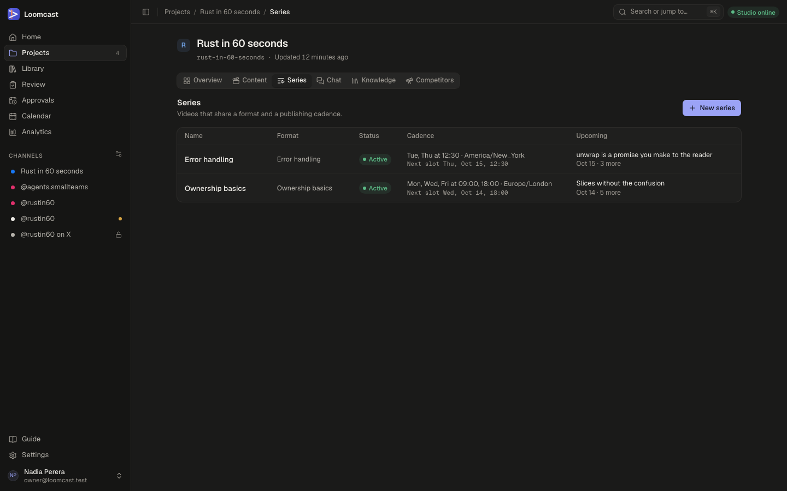
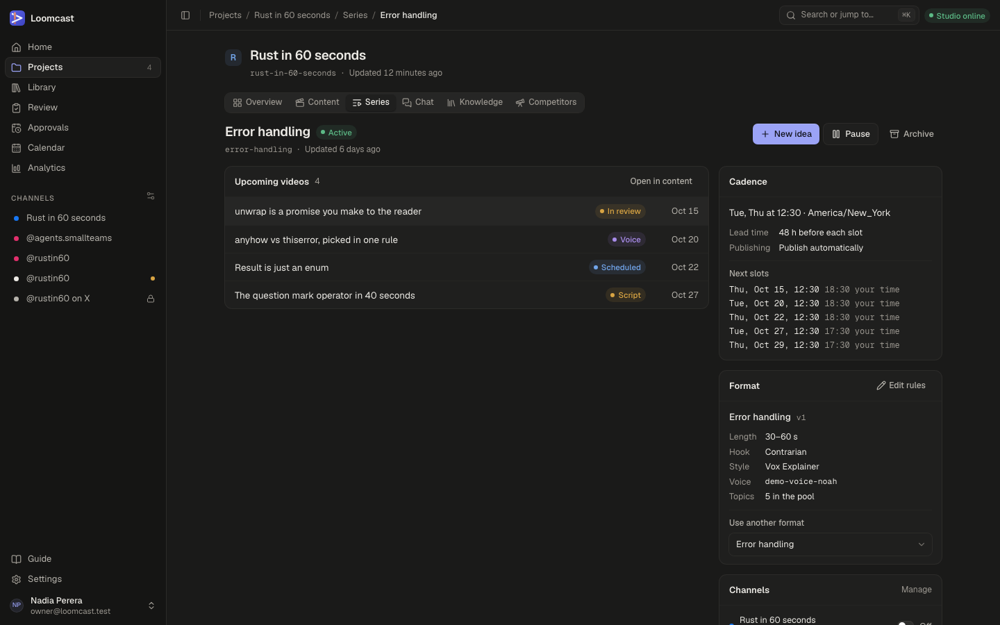
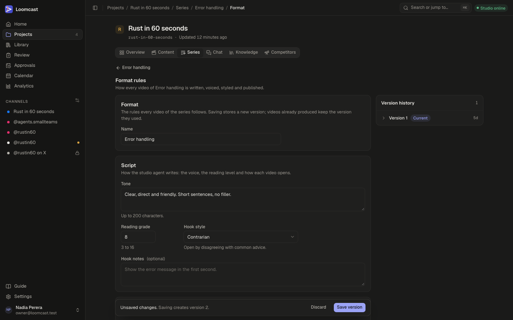

# Series and formats

A series is a run of videos that share one set of rules and publish on a schedule, such as "Ownership basics, three times a week". The rules live in the series' format: how the studio agent writes, how long the videos run, which voice and visual style they use, when they publish and whether they wait for approval. This page covers the series list, a series page, linked channels, the format editor and format versions.

## How series, formats and videos fit together

- A **project** can hold several series.
- Each **series** follows exactly one **format**. Several series may share a format; a change to it then applies to all of them.
- Every save of a format creates a new **format version**. A video in production keeps the version it started with, so changing a format never alters work that is already running.
- The format's **cadence** turns into **slots**: each day and time it lists is one slot. The server plans an idea for each upcoming slot and starts producing it ahead of time.
- The series' **channels** decide where its videos are posted.

## The series list

Open a project and choose the **Series** tab.

Each row shows:

| Column | What it shows |
|---|---|
| **Name** | The series. Press the row to open it |
| **Format** | The format it follows |
| **Status** | **Active**, **Paused** or **Archived** |
| **Cadence** | The days, times and time zone, and the next slot. "No slots while not active" for a paused series |
| **Upcoming** | The next video and its date, and how many more are planned |

Archived series are hidden. Press **Show archived** below the list (it shows how many there are) to see them, and **Hide archived** to hide them again.

### Creating a series

1. In the **Series** tab, press **New series**.
2. Type a **Name**, for example "Ownership basics".
3. Choose a **Format**:
   - **New format with default rules** creates a format named after the series. The format editor opens next, so you can set its rules straight away.
   - Pick an existing format to share its rules with the series that already use it. The series page opens next.
4. Press **Create series**.

The default rules publish on Monday, Wednesday and Friday at 09:00 UTC, wait for approval, and have no voice. Until you set a **Voice ID**, production stops before the voice step, so set it before you rely on the cadence.

## The series page

Press a series in the list to open its page.

The header shows the name, the status and the slug, with these buttons:

- **New idea** adds a video idea to this series. See [Videos and review](videos-and-review.md).
- **Pause** stops planning new videos (see below). A paused series shows **Resume** instead.
- **Archive** retires the series.

### Upcoming videos

The list on the left shows the series' videos that are not published or archived yet, soonest target date first, with their state (for example **Script**, **Voice**, **In review** or **Scheduled**). Press a video to open it, or **Open in content** to see the series in the project's **Content** tab.

### The Cadence card

The **Cadence** card summarises when the series publishes:

- the days, times and time zone, for example "Tue, Thu at 12:30 · America/New_York";
- **Lead time**: how long before each slot production starts, for example "48 h before each slot";
- **Publishing**: **Wait for approval** or **Publish automatically**;
- **Next slots**: the next five slots in the series' time zone and, when yours differs, in your time.

To change any of it, edit the format (below).

### The Format card

The **Format** card shows the format's name and current version (for example **v1**) and the main rules: **Length**, **Hook**, **Style**, **Voice** and how many **Topics** are in the pool.

- **Edit rules** opens the format editor.
- **Use another format** switches the series to another format of the project. It appears when the project has more than one format. The cadence is planned again at once with the new format's rules.

### Linked channels

The **Channels** card lists the project's channels with an **On**/**Off** switch for this series. A series publishes only to channels that are switched on.

- Switching a channel **on** plans the series' upcoming slots on it.
- Switching it **off** plans nothing new there and withdraws its planned posts for videos that are not approved yet. Posts that are queued with an approved video, or already published, stay.
- A note next to a channel says **dry run** when the channel only records what it would send, and **approval** when every post to it needs a person's approval.
- **Manage** opens **Settings → Channels**, where you connect accounts and change those settings. See [Publishing](publishing.md).

If no channels exist yet, the card links to Settings so you can add one.

### Pausing and archiving

| Action | What happens |
|---|---|
| **Pause** | No new videos are planned for its slots. Ideas planned for upcoming slots that have not been started are archived. Videos already in production carry on |
| **Resume** | Planning starts again from the next slots |
| **Archive** | The series stops planning videos and moves to the archived list. Its videos stay in the library. There is no button to bring an archived series back |

Pause and Archive ask you to confirm first. A paused or archived series shows a banner under its header explaining its state.

## The format editor

Open it with **Edit rules** on the series page. The button reads **View rules** when the series or the project is archived; in an archived project the editor is read-only.

The editor has these sections. The hint below a field gives its limits.

### Format

**Name** is the format's name. When several series share the format, the section says so and lists them: your changes apply to all of them.

### Script

How the studio agent writes:

- **Tone**: a sentence or two on voice and manner, up to 200 characters. The default is "Clear, direct and friendly. Short sentences, no filler."
- **Reading grade**: 3 to 16. Lower is simpler.
- **Hook style**: how each video opens. **Question**, **Bold claim**, **Statistic**, **Story**, **Contrarian** or **Demo**.
- **Hook notes** (optional): anything specific about the opening, for example "Show the error message in the first second."

### Length

**Shortest (seconds)** and **Longest (seconds)**, between 5 and 180. A render outside the range is not refused, but the video gets a note saying so.

### Voice

- **Voice ID**: the voice provider's (ElevenLabs) voice ID. Without one, production stops before the voice step and the video shows the reason as its last error.
- **Speed**: 0.7 to 1.3; 1 is normal.

### Visuals

- **Style**: the look from the studio's style library, for example **Vox Explainer** (the default). The hint describes each style.
- **Recipe**: a recipe skill that strings the production steps together for this kind of video.
- **Layout template**: a card id within the style. Leave it empty to let the studio pick.
- **Burned-in captions**, and **Caption style**: **Word by word** (highlights each spoken word) or **Whole lines**.

### Topics

- **Topic pool**: where new ideas come from. Type a topic and press Enter, or paste several lines to add one per line. Each idea the cadence plans takes the topic used least recently.
- **Avoid**: words, claims or topics the studio agent must leave out.

### Cadence

- **Days**: the weekdays the series publishes.
- **Times**: local times in the series' time zone, up to 12 a day. **Add time** adds another.
- **Time zone**: slots follow this zone's daylight saving changes, so 09:00 stays 09:00 there all year.
- **Lead time (hours)**: 1 to 336. Production of each video starts this long before its slot. Leave enough time for the render and for review if the series waits for approval.
- **Next slots** previews the slots these settings give, in the series' zone and in yours.

No days or no times means no slots: nothing is planned automatically, but you can still add ideas by hand.

### Publishing

- **Publish mode**:
  - **Wait for approval**: every video waits in **Review** until someone approves it. Nothing publishes on its own.
  - **Publish automatically**: a rendered video is approved by the system when it reaches review and publishes at its slot. Channels that require approval still wait for a person.
- **Hashtags**: up to 30, letters, digits and underscores. The # is added when posting.
- **Call to action** (optional): a line added to every caption, for example "Follow for one Rust error a day."

### Saving

The bar at the bottom shows "Unsaved changes. Saving creates version 2." (or the next number) while you edit.

- **Save version** (or ⌘S, Ctrl+S) saves your changes as a new version. A message confirms "Saved as version 2".
- **Discard** throws your changes away.
- If a field is wrong, the bar says how many fields to fix, and each one shows its error.

If someone else saves the format while you are editing, a banner appears. Choose **Discard my changes and load it** to start from their version, or, if your save was refused, **Load newer version** or **Save mine over it**.

Saving a format plans its series' slots again straight away, so a cadence change shows on the series page and the calendar within moments.

## Format versions

The **Version history** card next to the editor lists every version, newest first, with **Current** on the one in use. Expand a version to see what changed from the one before: each changed rule with its old value struck out and the new one next to it. A rename alone shows "Same rules as version 1, such as after a rename."

What versions mean in practice:

- A video's production steps each use the format version that was current when the step was queued. Saving a new version affects the next steps, not the one running.
- Videos already produced keep the version they used.
- The history is read-only. To go back to earlier rules, set the fields to the old values and save; that creates a new version.

## Related pages

- [Projects and the producer chat](projects.md) for the project the series belongs to.
- [Videos and review](videos-and-review.md) for producing and approving the videos of a series.
- [Publishing](publishing.md) for channels, dry run, the calendar and going live.
