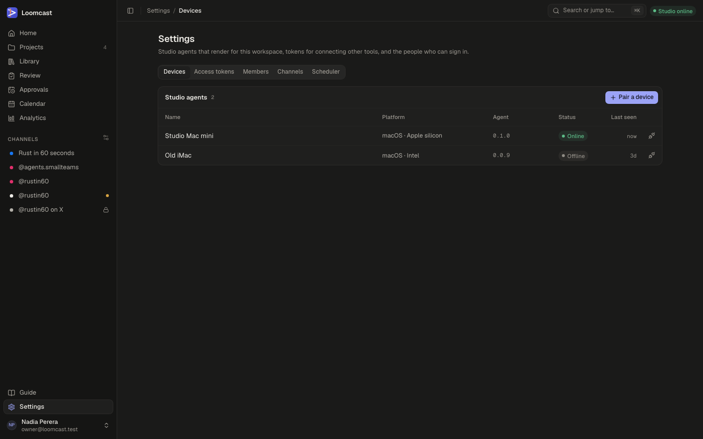
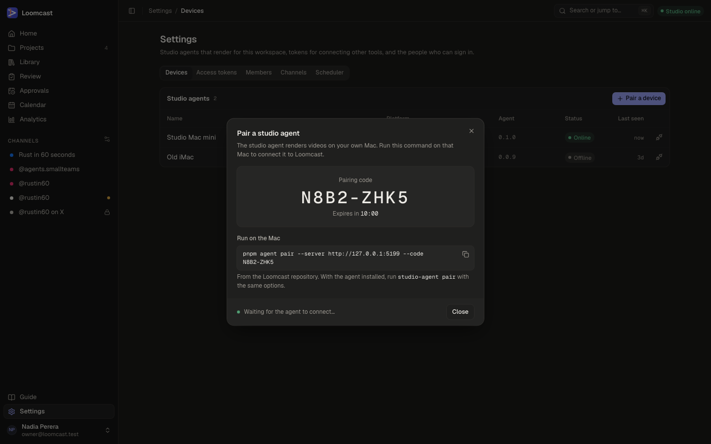
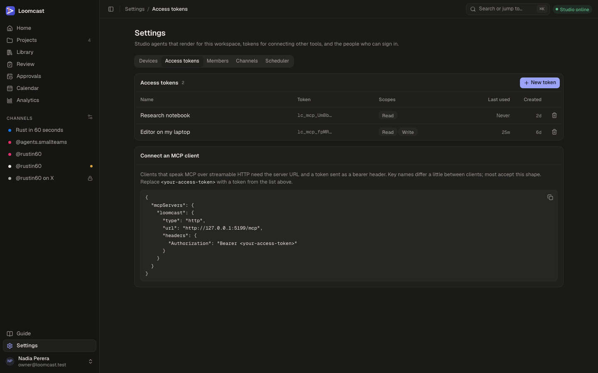
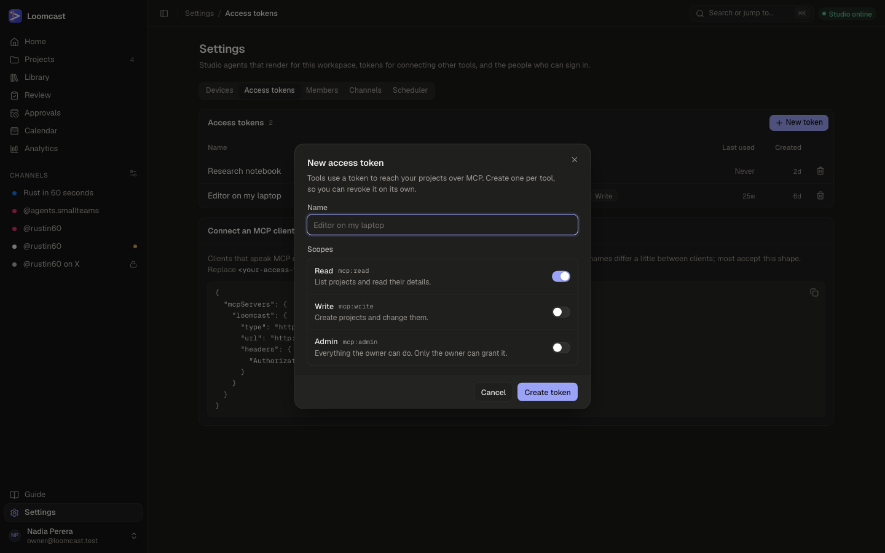
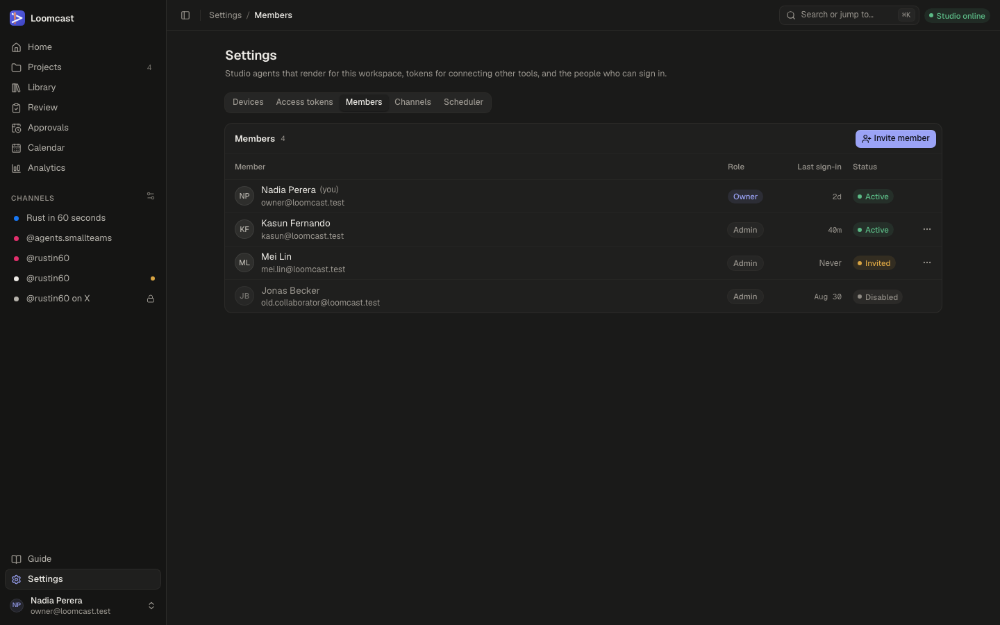
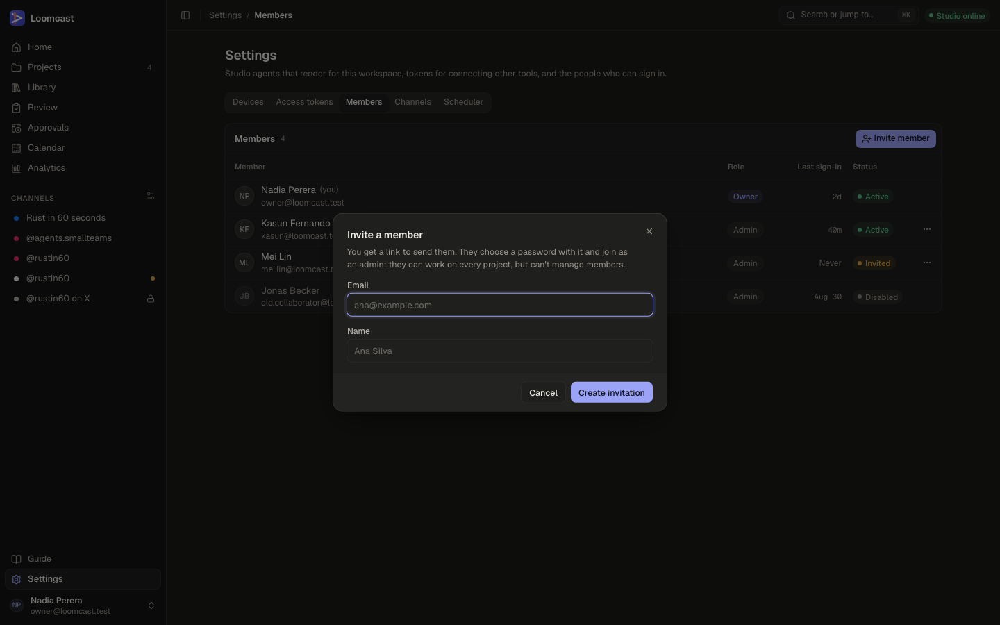
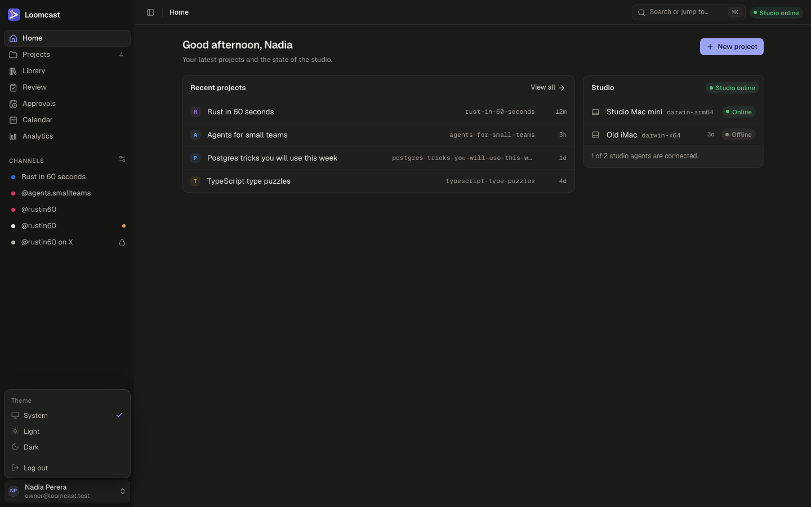

# Settings

Loomcast has two kinds of settings:

- **Workspace settings** belong to the open workspace: its name, description, icon, colour and time zone, its publishing channels and its API clients. Each workspace has its own. Open them from **Workspace settings** at the bottom of the sidebar, or **Settings** on the workspace's overview.
- **Account settings** are not part of any workspace: the studio agents paired with Loomcast, access tokens for other tools, members and the scheduler's failed tasks. Open them from **Account settings** at the bottom of the sidebar.

You can also type a section's name in **Search or jump to…** (⌘K).

Every member is either the owner or an admin, and both see every workspace. Admins can use every tab except **Members** in account settings and **API clients** in workspace settings, which only the owner sees.

## Workspace settings

Workspace settings has three tabs: **General**, **Channels** and **API clients**. It opens on **General**. The tabs always act on the open workspace; switch workspaces with the switcher at the top of the sidebar to change another one.

### General

**General** holds the workspace's **Name**, its description (**About**), its **Icon and colour**, its **Time zone** (the calendar's default) and **Archive this workspace**. Each is described in [Workspaces and the producer chat](workspaces.md#workspace-settings).

### Channels

**Channels** are the accounts the workspace's series publish to: Facebook Pages, Instagram and Threads accounts. Each channel belongs to one workspace, and this tab lists only the open workspace's channels. You can also open it from the settings icon next to **Channels** in the sidebar, or **Manage channels** on the overview.

From this tab you:

- connect an account with **Connect**, or add a channel to plan posts on before connecting one with **Add planning channel**. After the sign-in, Loomcast asks which workspace the accounts join, starting with this one;
- see each channel's status: **Active**, **Not connected**, **Needs reconnect** or **Disabled**;
- turn **Dry run** on or off. Dry run records the exact request a post would send without publishing it;
- turn **Approval** on or off. Approval makes every post on the channel wait for a person, whatever the series' publish mode;
- use **⋯** to **Rename…**, **Reconnect** or **Disconnect…** a channel.

A banner at the top says when the whole server is in dry-run mode or publishing is paused. A channel marked **Dry-run only** cannot publish live on this server.

How to connect each platform, what happens when an account is already in another workspace, how to go live and how to fix channels that need reconnecting is in [Channels, calendar and publishing](publishing.md).

### API clients

**API clients** let another backend you run schedule posts on the workspace's channels through Loomcast's REST API, each channel at a level you pick (read, write or publish). A client belongs to the workspace it was created in and can only be given that workspace's channels. Only the owner sees this tab. See [API clients](api-clients.md).

## Account settings

Account settings has one tab per section: **Devices**, **Access tokens**, **Members** and **Scheduler**. **Members** is shown only to the owner. Opening **Account settings** without a tab takes you to **Devices**.

Channels and API clients used to be tabs of a single Settings page, shared by every workspace. Old links to `/settings/channels` and `/settings/api-clients` now open those tabs in a workspace's settings.

### Devices

**Devices** lists the studio agents paired with Loomcast. One studio agent works for every workspace. A studio agent is the program on your Mac that renders videos and runs producer work; see [Setting up the studio agent](studio-agent.md).



The **Studio agents** table shows, for each device:

| Column | What it shows |
|---|---|
| **Name** | The name given when the device was paired |
| **Platform** | The Mac's system and processor |
| **Agent** | The studio agent's version |
| **Status** | **Online** while the agent is connected, **Offline** otherwise |
| **Last seen** | When the agent was last connected, or **Never** |

The **Studio online** pill in the top bar is green when at least one device is online. A device that is **Offline** cannot take jobs; work waits in the queue until a studio agent comes back online.

#### Pair a device

1. Select **Pair a device**. The **Pair a studio agent** dialog shows a pairing code.
2. Under **Run on the Mac**, select the copy button and run the command in a terminal on that Mac, from the Loomcast repository. It looks like this:

   ```bash
   pnpm agent pair --server https://loomcast.example.com --code <code>
   ```

   With the studio agent installed, `studio-agent pair` takes the same options.
3. Keep the dialog open. It shows "Waiting for the agent to connect…", then closes with **Studio agent paired** once the Mac connects.



A code lasts ten minutes and works once. If it expires, select **Get a new code**. The full set-up, including installing and starting the agent, is in [Setting up the studio agent](studio-agent.md).

#### Revoke a device

Revoke a device you no longer use, or one that was lost or replaced.

1. Select the revoke icon at the end of the device's row.
2. Select **Revoke device** to confirm.

The device disconnects at once and cannot take render jobs until you pair it again.

### Access tokens

**Access tokens** are for connecting other tools to Loomcast over MCP, for example an editor or a research notebook that should read or create workspaces. The studio agent does not need one; it uses its own device token from pairing.



The table shows each token's **Name**, the start of the **Token**, its **Scopes**, when it was **Last used** and when it was **Created**.

#### Create a token



1. Select **New token**.
2. In **Name**, name it after the tool that will use it, for example "Editor on my laptop". Create one token per tool, so you can revoke one without breaking the others.
3. Turn on the scopes the tool needs:

   | Scope | Allows |
   |---|---|
   | **Read** (`mcp:read`) | List workspaces and read their details |
   | **Write** (`mcp:write`) | Create workspaces and change them |
   | **Admin** (`mcp:admin`) | Everything the owner can do. Only the owner sees and can grant it |

4. Select **Create token**.
5. Select **Copy token** and paste it into the tool's settings. This is the only time the token is shown; Loomcast keeps just enough to recognise it. If you lose it, revoke it and create a new one.
6. Select **Done**.

#### Connect a tool

Under **Connect an MCP client**, copy the configuration and paste it into the tool's MCP settings. Replace `<your-access-token>` with the token you copied. Key names differ a little between tools, but most accept this shape. The full reference, including every tool and error, is in the [MCP documentation](../mcp.md).

#### Revoke a token

Select the bin icon at the end of the token's row, then **Revoke token**. Tools using it lose access at once. This cannot be undone.

### Members

**Members** is where the owner invites people and manages their access. Only the owner sees this tab.



The table shows each member's name and email, **Role**, **Last sign-in** and **Status**:

| Status | What it means |
|---|---|
| **Active** | The member has set a password and can sign in |
| **Invited** | The member has an invitation but has not set a password yet |
| **Disabled** | The member's access was disabled. They cannot sign in |

There are two roles. The **Owner** manages members. Everyone invited joins as an **Admin**: they can work in every workspace, but cannot manage members or API clients.

#### Invite a member



1. Select **Invite member**.
2. Enter their **Email** and **Name**, as teammates will see it.
3. Select **Create invitation**.
4. Select **Copy link** and send the link to them privately, for example in a direct message. Loomcast does not email it for you.
5. Select **Done**.

The link opens a page where they choose a password (at least 12 characters) and join Loomcast. It works once and lasts 7 days. This is the only time the link is shown; if it gets lost, create a new one with **New password link**.

#### Send a new password link

Use this when a member has forgotten their password, or an invitation expired.

1. Select **⋯** at the end of the member's row, then **New password link**.
2. Select **Create link**.
3. Copy the link and send it to them privately.

Any earlier link for them stops working. Their current password keeps working until they use the new link, and their other sessions end once they set the new password. A reset link lasts 24 hours and works once.

#### Disable a member

1. Select **⋯** at the end of the member's row, then **Disable access**.
2. Select **Disable access** to confirm.

They are signed out everywhere and cannot sign in again. Their access tokens and unused links stop working, and the studio devices they paired are disconnected and revoked. Their work stays in the workspaces.

### Scheduler

The scheduler is the part of the server that plans cadence slots, starts production, publishes posts, checks their status, refreshes channel access and pulls insights. **Scheduler** shows the tasks that need you, for every workspace at once.


The line above the table says when the scheduler last ran and whether publishing is live or dry-run. If it last ran more than five minutes ago, the line turns amber and says "Check that the server is running." If it says "The scheduler hasn't run yet.", the server's scheduler has not started; see [Deploying and running the server](operations.md).

**Tasks needing attention** has two views:

- **Dead**: every attempt of the task failed. Each task gets 3 to 5 attempts, with growing waits between them.
- **Failed**: the task hit an error that retrying on its own cannot fix.

Each row shows the **Task** (such as **Publish a post** or **Verify channel access**), what it is **For**, the **Attempts** used, the **Last error** and **When** it ended.

#### Retry a task

1. Read the **Last error** and fix the cause first. For example, reconnect a channel in its workspace's **Workspace settings → Channels** when the error is about access, or wait for the platform when it timed out.
2. Select **Retry**. The task runs again now with a fresh set of attempts, and Loomcast shows **Task queued again**.

If another run of the same task is already waiting or running, the retry is refused. A post that failed to publish is handled on the post itself; move it to a new time on the calendar to queue it again (see [Channels, calendar and publishing](publishing.md)).

## The user menu

Your name and email are at the bottom of the sidebar. Select them to open the user menu:



- **Theme**: choose **Light**, **Dark** or **System**. The change applies at once and is remembered on this browser.
- **Log out**: signs you out of this browser.

There is no profile page. To change an admin's password, the owner sends them a new password link (see [Send a new password link](#send-a-new-password-link)).
