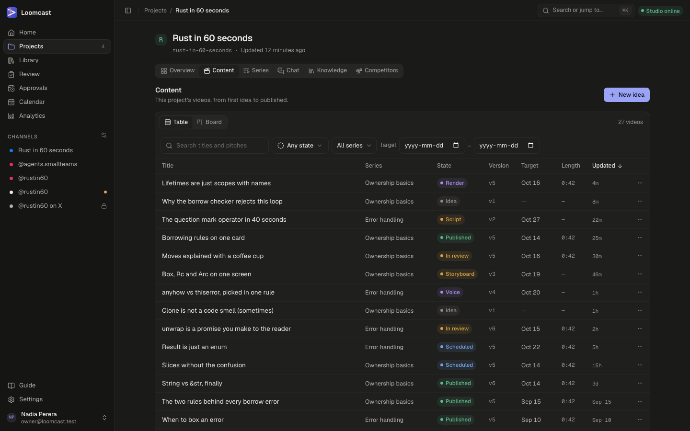
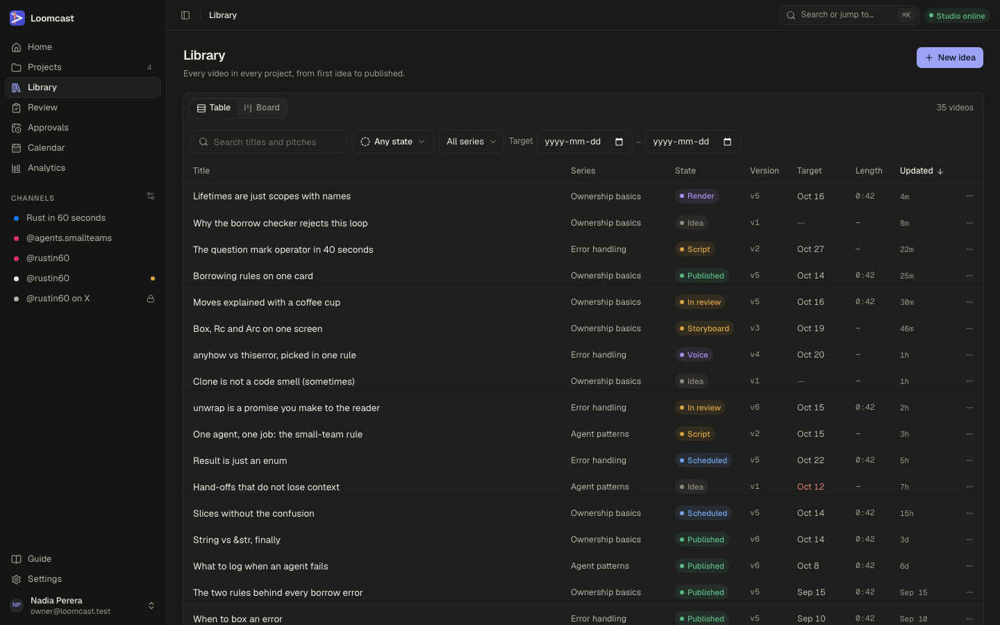
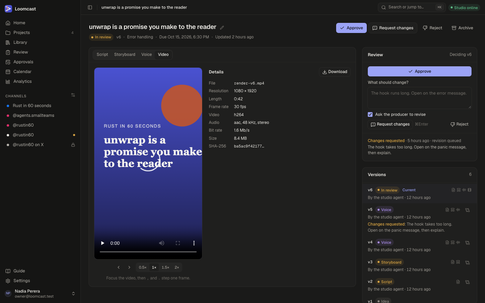
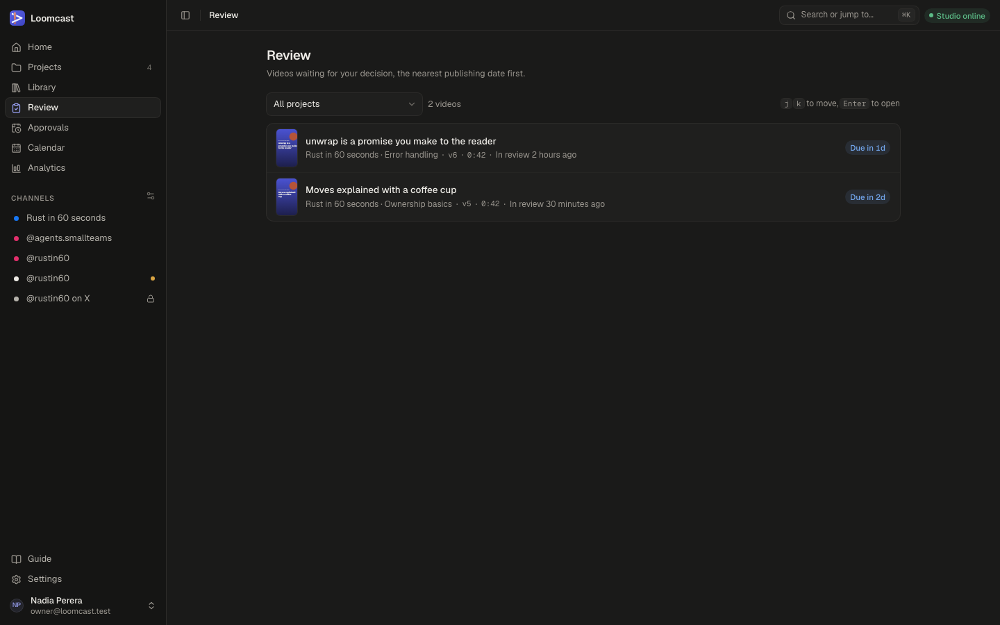
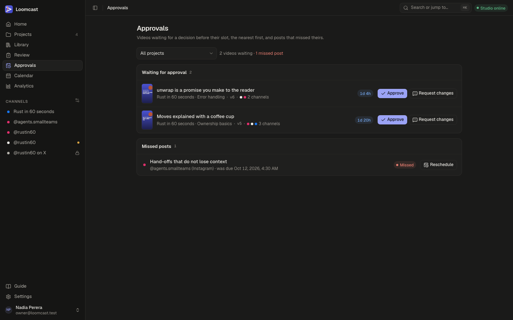

# Videos, review and approvals

Every short video in Loomcast is a content item. It starts as an idea, the studio agent produces it step by step, and a person decides whether it is good enough to publish. This page explains the states a video passes through, where to find your videos, how to read a video's page, and how to approve, send back or reject it.

## The pipeline

A video moves through these states in order. The state is shown as a coloured label everywhere a video appears: in the library, on the board, in the review queue and on the video's own page.

| Label | What it means | What moves it here |
|---|---|---|
| **Idea** | A title and an optional pitch. Nothing has been made yet. | Adding an idea, or restoring an archived video. |
| **Script** | The video has a script. | The studio agent writes or revises the script, you edit it, or someone requests changes. |
| **Storyboard** | It also has a storyboard: one card per segment of the script. | The studio agent lays out the storyboard, or you edit it. |
| **Voice** | It also has a voice take. | The studio agent records the script with the voice provider (ElevenLabs), or you pick another take. |
| **Render** | It also has a rendered video and a poster. | Only when production was asked to stop after the render. |
| **In review** | A rendered video waits for a person's decision. | The render finishes, or a finished video is submitted for review. |
| **Approved** | A person approved the current version. | **Approve**. |
| **Scheduled** | Approved, with its posts queued for their slots. | Approval, once the video has at least one post planned on a channel. |
| **Published** | Its first post went out (live, or recorded as a dry run). | The publisher, at the post's time. |
| **Archived** | Out of the pipeline and hidden from the library. | **Archive** or **Reject**. |

The production work (script, storyboard, voice and render) runs as jobs on the studio agent on the Mac. If the studio agent is offline, the jobs wait in the queue and start when it comes back. See [The studio agent](studio-agent.md).

### Producing a video

You rarely need to run each step by hand. **Produce** (on a video's page) or **Produce through review** (in a video's **⋯** menu in the library) starts autopilot: the studio agent runs the first missing step, and each step that succeeds starts the next one, until the video is rendered and lands in review.

Autopilot stops and the video page shows the reason as its last error when:

- a job fails or is cancelled;
- the video changed while the job ran, so its result no longer fits;
- the next step cannot start, for example because the series' format has no voice set.

Fix the cause and press **Produce** again. It continues from where the video is. A manual step (for example editing the script) turns autopilot off so it never overwrites your work.

While a job runs, a banner on the video page says what is happening ("Waiting for the studio agent to pick it up.", "The studio agent is working on it.") with a **Cancel** button.

### Approval is always a person's decision

The producer session can also hand in a finished render itself. Through the MCP tool for submitting content, it uploads the video and its poster and submits them as a new version, and the video goes straight to **In review**. This never approves anything. Access tokens and the producer session cannot approve; only a signed-in person can.

The one exception is a series whose format is set to **Publish automatically** and whose channels do not require approval: there the system approves a video when it enters review. See [Approval rules](publishing.md#approval-rules).

## Finding your videos

### The project's Content tab

Open a project and choose the **Content** tab. It lists that project's videos, from first idea to published.

### The Library

**Library** in the sidebar shows every video in every project in the same layout.

Both views work the same way:

- **Table** and **Board** switch between a sortable list and a board with a column per state.
- **Search titles and pitches** filters as you type.
- **Any state** limits the list to one or more states.
- **All series** limits it to one series.
- **Target** takes a date range for the target date.
- Click a title to open the video. The **⋯** menu on a row offers **Produce through review**, **Open** and **Archive**.

The columns show the series, the state, the current version (**v5** is the fifth version), the target date (red when it has passed), the video length once rendered, and when it was last updated.

### Adding an idea

1. Press **New idea** (top right of the Library or a project's Content tab).
2. Enter a **Title**. Add a **Pitch** if you want: the angle, the hook, or what the viewer should take away.
3. In the Library, choose the **Project**. In a project's Content tab, the project is already set.
4. Optionally choose a **Series**. The video then follows that series' format.
5. Press **Add idea**. A message confirms it with an **Open** link.

The new video is in the **Idea** state. Press **Produce** on its page to have the studio agent make it.

## The video page

Click any video to open its page. The header shows the title (the pencil renames it), the state, the current version, the series, the due date and when it last changed. The buttons on the right depend on the state: **Produce**, **Approve**, **Request changes**, **Reject**, **Archive**, or **Restore** for an archived video.

### Script, Storyboard, Voice and Video

The four tabs show the parts of the video:

- **Script**: the hook, the segments with their timing, the call to action, the caption and the hashtags. **Edit script** opens the editor; **Save as new version** keeps your change as a new version. Saving a changed script drops the voice and the video, which are then made again from the new words. **Compare with…** shows the differences against another version.
- **Storyboard**: one card per segment of the script, with the text on each card and its timing. You can edit a frame and save it as a new version.
- **Voice**: every voice take the video has had. **Use this take** switches to an earlier take; **Regenerate** records a new one.
- **Video**: the rendered video with a player, frame-by-frame stepping (the , and . keys) and playback speeds from 0.5× to 2×. **Details** lists the file name, resolution, length, frame rate, codecs, bit rate, size and checksum. **Download** saves the MP4.

If a part does not exist yet, the tab says so ("No script yet", "Not rendered yet").

### Versions

Every change makes a new version: each step of the studio agent, each edit you make and each submission from an MCP client. Versions are never changed or deleted. The **Versions** list on the right shows each one with its state, who made it ("By the studio agent", "Edited here", "From an MCP client"), icons for the parts it has, and any review decision taken on it. Click a version to view it; edits always start from the current one.

One pass from idea to review makes versions 2 to 5 (script, storyboard, voice, render). A revision after a request for changes adds four more.

### Producer chat

Below the versions, **Producer chat** is a conversation with the producer session about this one video. Use it to ask questions about the script or to talk through changes.

## Reviewing a video

When a video is **In review**, its page shows the **Review** panel on the right, headed "Deciding v6" (or whichever version you are looking at). Watch the video in the **Video** tab first, then decide.

### Approve

Press **Approve**. Approving needs a rendered video. The video moves to **Approved**, and to **Scheduled** as soon as its planned posts are queued. See [Channels, calendar and publishing](publishing.md).

### Request changes

1. In **What should change?**, write what you want, for example "The hook runs long. Open on the error message."
2. Leave **Ask the producer to revise** ticked if you want the studio agent to do the work. Untick it to make the changes yourself.
3. Press **Request changes** (or ⌘Enter, Ctrl+Enter on Windows and Linux).

With **Ask the producer to revise** ticked, the producer revises the script using your comment as its instructions, then storyboards, voices and renders it again, and the video comes back to review as a new version. Without it, the video stays at the **Script** stage for you to edit.

### Reject

Press **Reject** and confirm. The video is archived and leaves the pipeline. You can restore it later as an idea.

### Archive and restore

**Archive** takes a video out of the pipeline at any stage and hides it from the library; any open posts are cancelled. **Restore** on an archived video brings it back as an idea.

Every decision is kept with the version it was about and listed under the Review panel and in the versions list.

## The Review queue

**Review** in the sidebar lists every video waiting for your decision, the nearest target date first. Each row shows a poster, the project and series, the version, the length, how long it has been in review and when it is due.

- **All projects** limits the queue to one project.
- **j** and **k** move up and down the list, and **Enter** opens the selected video.
- The decisions themselves are on the video page, in its Review panel.

## Approvals

**Approvals** in the sidebar is the inbox for videos that are waiting for a decision before a post is due to go out. It differs from the Review queue in two ways: it counts down to each video's first planned post, and it lets you decide from the list.

### Waiting for approval

Each row shows the video, its series and version, the channels its posts go to, and the time left before its first slot. The countdown turns blue within three days, amber within a day and red under two hours or once the slot has passed. A video with no post planned shows **No slot**. The summary above the list counts the videos waiting and how many are due within a day.

- **Approve** approves the video straight from the row.
- **Request changes** opens a box under the row. Write what should change, choose whether to **Ask the producer to revise**, and press **Send** (or ⌘Enter).

Open the video (click its title) if you want to watch it first.

### Missed posts

A post is missed when its time comes before its video is approved. Missed posts are listed below, the most recent first. To publish one anyway:

1. Approve the video.
2. Press **Reschedule** on the missed post, pick a **New time** at least two minutes ahead, and confirm.

The post waits for its new time and publishes once the video is approved. If you do not want it, leave it.

## When something goes wrong

- **Produce or Approve is greyed out.** A job is already running on the video. Wait for it, or cancel it from the banner.
- **The voice step is refused.** The series' format has no voice set. Set one in the format editor ([Series and formats](series-and-formats.md)) and press **Produce** again.
- **A job never starts.** The status pill in the top bar says the studio is offline. Start the studio agent on the Mac ([The studio agent](studio-agent.md)).
- **The render fails with a storyboard issue.** A frame runs longer or shorter than its card allows, or past the end of the voice. Revise the storyboard or regenerate the voice, then render again.
- **"Showing v3, an earlier version."** You are looking at an older version from the versions list. Click the version marked **Current** to go back.

For more, see [Troubleshooting](troubleshooting.md) and the technical [pipeline guide](../pipeline.md).
