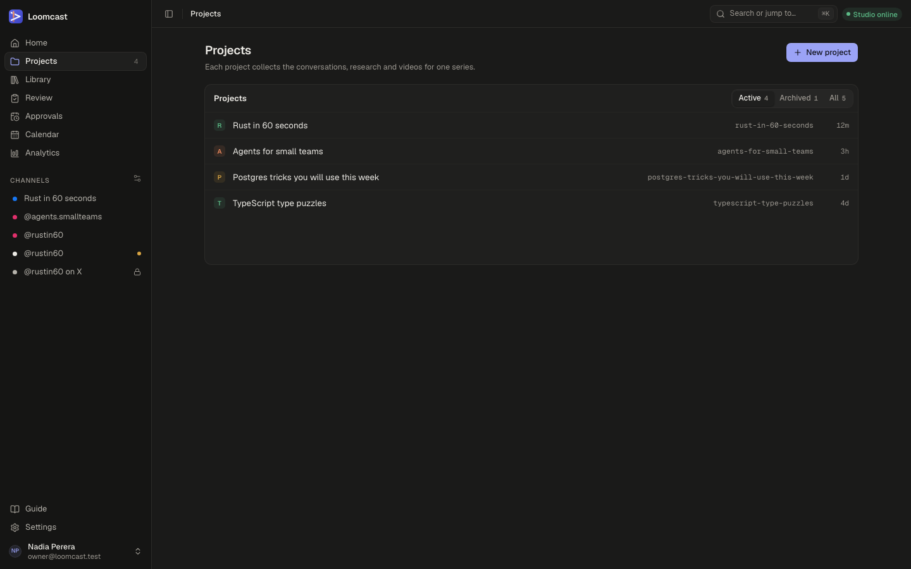
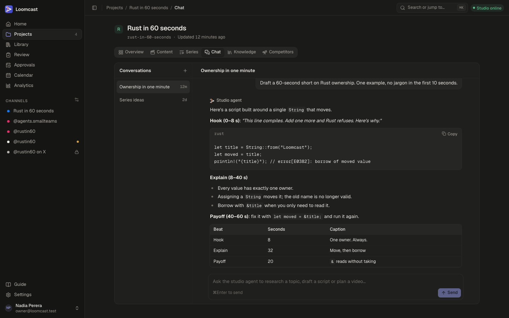

# Workspaces and the producer chat

A workspace is one brand, for example "Unfolded" or "Maths is Beautiful". Everything for that brand lives inside it: its channels, calendar, library, review queue, approvals, analytics, chat, knowledge base, series and formats, competitors and API clients. This page covers opening and switching workspaces, creating one, the overview, the workspace's own settings (name, description, icon, colour and time zone), archiving, and the **Chat** page where you talk to the producer session on the studio agent.

## What a workspace holds

Each workspace has its own:

| Part | What it is | See |
|---|---|---|
| **Channels** | The Facebook Pages, Instagram accounts and Threads profiles the brand publishes to. A channel belongs to exactly one workspace | [Channels, calendar and publishing](publishing.md) |
| **Calendar**, **Library**, **Review**, **Approvals** and **Analytics** | The brand's posts, videos, decisions and results | [Videos, review and approvals](videos-and-review.md) |
| **Chat** and **Knowledge** | Conversations with the producer session, and the ideas, references and decisions it reads | Below, and [The knowledge base](knowledge-base.md) |
| **Series** and formats | Runs of videos with shared rules and a cadence | [Series and formats](series-and-formats.md) |
| **Competitors** | Profiles you follow and what their videos do | [Competitor research](competitor-research.md) |
| **API clients** | Other backends that post on the workspace's channels | [API clients](api-clients.md) |

Everyone who can sign in sees every workspace; there is no per-workspace membership. Devices, access tokens, members and the scheduler are not part of a workspace: they are in **Account settings** (see [Settings](settings.md)).

## Opening and switching workspaces

Loomcast always works inside one workspace at a time. Its pages live under `/w/<slug>/`, for example `/w/rust-in-60-seconds/calendar`.

- Opening your Loomcast address takes you to the workspace you last opened in this browser. If there is none, or it has been archived, you land in the most recently changed active workspace, or on the workspaces list when there is no active workspace.
- **The switcher** at the top of the sidebar shows the open workspace's icon and name. Press it to see the active workspaces (a tick marks the open one), **All workspaces** and **New workspace…**. Picking a workspace opens its overview.
- **The command palette** (⌘K, or Ctrl+K) finds workspaces by name or slug from anywhere.

The sidebar items below the switcher (**Overview**, **Calendar**, **Library**, **Review**, **Approvals**, **Analytics**, and under **Studio**: **Chat**, **Knowledge**, **Series** and **Competitors**) all open pages of the open workspace, and so does the **Channels** list under them.

Links saved before workspaces had their own addresses still work. Old addresses such as `/projects/<slug>/kb`, `/workspaces/<slug>/kb`, `/calendar`, `/library`, `/review` or `/settings/channels` open the same page in a workspace.

## The workspaces list

Press the switcher and choose **All workspaces** (the address is `/workspaces`).

Each card shows the workspace's icon on its colour, its name and slug, its description and how long ago it last changed. Press a card to open the workspace. Archived workspaces are hidden: turn on **Show archived** (the number next to it counts them) to list them below the active ones.

## Creating a workspace

Create one workspace per brand.

1. Press **New workspace** on the workspaces list, or choose **New workspace…** in the switcher. You can also run **New workspace** from the command palette.
2. Type a **Name**, for example "Rust in 60 seconds". Below the field, Loomcast shows the slug it will use in the workspace's address.
3. Optionally add a **Description**: what the videos are about and who they are for. The studio agent reads it, so a clear sentence helps.
4. Press **Create workspace**.

A "Workspace created" message appears and the new workspace opens on its overview. Slugs never change, even when you rename the workspace, so links keep working. A new workspace starts with the **Thread** colour, no icon and the UTC time zone; change them in its settings (below). Next, connect its channels (see [Channels, calendar and publishing](publishing.md#connecting-an-account)) and add a series.

## The overview

**Overview** in the sidebar opens the workspace's home page.

- The header shows the workspace's icon, name and when it last changed, with an **Archived** badge when it is archived. **Settings** opens the workspace settings.
- **About** holds the description. Press **Edit** to change it, then **Save** (or ⌘Enter). Escape cancels.
- The counts show **Conversations**, **Knowledge entries**, **Tags** and **Last change**.
- **Recent knowledge** lists the latest knowledge base entries; **Open knowledge** opens the knowledge base.
- **Recent conversations** lists the latest chats; press one to open it in **Chat**.
- **Channels** lists the workspace's channels with their platform and status. Press one to open the calendar filtered to it, or **Manage channels** to open the channel settings.

## Workspace settings

**Workspace settings** at the bottom of the sidebar (or **Settings** on the overview) holds the settings of the open workspace. It has three tabs: **General**, **Channels** and **API clients**. **API clients** is shown only to the owner. **Channels** and **API clients** are described in [Settings](settings.md#workspace-settings).

**General** has these cards:

- **Name.** Type a new name and press **Save name**. The slug stays the same.
- **About.** The description, as on the overview.
- **Icon and colour.** How the workspace is recognised in the sidebar, the switcher and the workspaces list.
  - **Upload icon** takes a PNG, JPEG or WebP image. Loomcast crops it to its centre square and resizes it to 256 × 256 pixels before it is saved, so nothing but the pixels is kept.
  - **Use a channel's picture** copies the profile picture of one of the workspace's channels. It is greyed out until a connected channel has a picture.
  - **Remove icon** goes back to the initial on the workspace's colour.
  - **Colour** is one of **Thread**, **Ember**, **Moss**, **Ocean**, **Plum**, **Amber**, **Rose** and **Slate**. It is shown behind the workspace's initial while it has no icon.
- **Time zone.** The calendar shows times in this time zone unless you choose another in its time zone menu. A series keeps its own time zone for its cadence (see [Series and formats](series-and-formats.md)).
- **Archive this workspace.** See below.

Each change is saved at once and confirmed with a short message.

## Archiving a workspace

Archive a workspace when you stop working on it. Its conversations and knowledge stay readable, but no new conversations or messages can be added, its series and formats can no longer be changed, and competitors can no longer be added or scanned.

1. Open **Workspace settings**. The **General** tab opens.
2. In **Archive this workspace**, press **Archive workspace**.
3. Confirm with **Archive workspace** in the dialog.

The workspace leaves the switcher and moves to the archived part of the workspaces list, and its overview shows an **Archived** badge. The web app has no button to restore an archived workspace.

## The producer chat

**Chat** in the sidebar is where you work with the studio agent in plain language. Each message you send becomes a job. The studio agent on your Mac picks it up and runs one turn of a producer session inside the workspace's own folder on the Mac, and the reply streams back into the conversation as it is written.

### Starting and continuing a conversation

- The left column lists the workspace's conversations, most recent first. Press one to open it. On a phone, the list becomes a picker above the thread.
- Press **+** at the top of the list to start a **New conversation**. If the workspace has no conversations yet, your first message starts one.
- A conversation without a title is named after when it started, for example "Conversation, Oct 14, 9:30 AM".
- Type in the box at the bottom and press **Send**, or ⌘Enter (Ctrl+Enter). Enter on its own adds a new line.

Each conversation keeps its producer session, so the studio agent remembers what was said earlier in the same conversation. Start a new conversation for a new subject; it starts with a clean slate.

Replies are formatted: headings, lists, tables and code blocks. Code blocks have a **Copy** button.

### What the studio agent can do in a chat

In a chat turn the producer session can:

- search and read the workspace's knowledge base;
- save to the knowledge base: brainstorms, decisions (with their rationale) and references to videos;
- read the workspace's details, such as its description;
- search the web and read web pages;
- read and write files in the workspace's folder on the Mac.

Use the chat to research a topic, brainstorm angles and hooks, draft or rework a script, plan a run of videos, or record a decision so that later scripts follow it. Ask it to save what you agreed ("save these five hooks as a brainstorm") and it appears in **Knowledge**.

The chat does not produce videos by itself. To turn an idea into a video, add it with **New idea** in the **Library** or on a series, then produce it. See [Videos and review](videos-and-review.md).

### The status line

While a reply is on its way, a status line sits above the message box:

| Status | Meaning |
|---|---|
| **Queued** | The message is saved and the job waits for the studio agent |
| **Waiting for studio agent (offline)** | The studio agent that holds this conversation, or every paired one, is offline |
| **Waiting for studio agent (none paired)** | No studio agent has been paired yet |
| **Starting** | The job was sent to the studio agent |
| **Running** | The studio agent is working. The detail says what it is doing, for example "Thinking", "Writing the reply" or the tool it is using |
| **Cancelling** | You pressed **Cancel** and the studio agent is stopping |
| **Failed** | The reply did not finish. The detail says why |
| **Cancelled** | You stopped the reply |

While a reply is queued or running you can press **Cancel**. After **Failed** or **Cancelled**, press **Retry** to send the same words again as a new message. A reply you stopped is marked **Studio agent (stopped)**.

### When the studio is offline

You can send messages while the studio agent is offline. Each message is saved straight away and its job waits in the queue, showing **Waiting for studio agent (offline)**. When the studio agent reconnects it picks the job up and the reply streams in. You do not need to keep the page open.

A conversation that already has a producer session stays with the studio agent that holds it. If you have paired more than one Mac, its messages wait for that Mac, even when another one is online. Start a new conversation to use the Mac that is online.

Common failures and what to do:

| Detail on a failed reply | What to do |
|---|---|
| "The studio agent lost its connection while working on this." | The Mac went to sleep, lost its network or the agent restarted. Check the studio status pill, then press **Retry** |
| "The reply took too long and was stopped." | Ask for less in one message, or split the task, then retry |
| "The producer session on the studio agent is signed out." | Sign the producer runtime in again on the Mac. See [The studio agent](studio-agent.md) |
| "This studio agent can't answer messages yet. Update it and try again." | Update the studio agent on the Mac |

More causes are in [Troubleshooting](troubleshooting.md).

## Tips for good briefs

- **Say what you want back.** "Draft a 45-second script with a hook, three beats and a payoff" works better than "write something about lifetimes".
- **Give the constraints.** Length, audience, reading level, what to avoid, and the one example the video is built around.
- **Point to what you already know.** "Use the decisions in the knowledge base about captions" or "follow the reference video I saved yesterday". The studio agent searches the knowledge base, but naming the entry helps.
- **Keep one subject per conversation.** A long conversation about many things is slower and drifts.
- **Save the outcome.** When you agree on hooks, angles or rules, ask the studio agent to save them as a brainstorm or a decision. Script jobs read the knowledge base too, so saved decisions shape later videos.
- **Put lasting rules in the format.** Tone, length, hook style and the topic pool belong in the series format, not in a chat message. See [Series and formats](series-and-formats.md).
